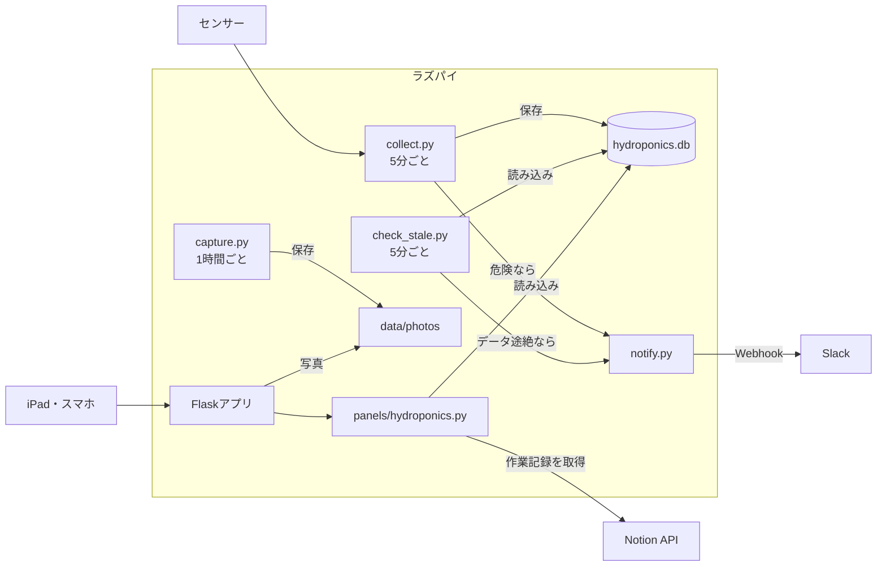

# 水耕栽培パネル 仕様書

Oct 12, 2026 · @しーたけ

## 1. 概要

部室ダッシュボードの右側の枠に載せる「水耕栽培パネル」と、その元データを集めるセンサー収集の仕様書です。部室の窓際にある水耕栽培キットで小松菜を育て、液温やECなどを測って「今やること」を示します。

対象のキットは部室のiDOOの水耕栽培キット（型番不明）です。容器に培養液を溜めて根を浸ける湛液式で、本体内蔵の水ポンプが液を動かします。本書の「タンク」は、この培養液の容器を指します。キットのLEDとタイマーは使わず、南向きの窓際の自然光で育てます。種はキットのポッドに直接まき、センサーの取り付けと同じ日に植え付けます。

**この仕様書の使い方**：コーディングエージェントが、本書と「部室ダッシュボード 仕様書」（以下、ダッシュボード仕様書）だけを読んで実装できるように書いています。画面配置・定期更新・エラー表示・認証などの共通部分はダッシュボード仕様書に従い、本書では重複して定義しません。パネルの接続はダッシュボード仕様書の第7章の約束に従い、同書の第8章で求められた5つの項目は本書の第9〜11・15章で定義します。書かれていないことは第2章の方針に従って最も単純な方法を選び、第16章の未決事項は設定値として後から変えられるようにしてください。

- **目的**：作物を枯らさずに育てるために、状態を見える化して「今やること」を示す。1年生がセンサー1つを担当して、開発を体験できるようにする。
- **期間**：2026年10月中旬〜12月中旬。冬休み前に収穫して終了する。
- **今回実装するもの**：センサー値の収集（cronで5分ごと）とSQLiteへの保存、開発用のダミーセンサー、確定したセンサーの読み取り（第5章。センサーの種類は未定）、3段階の判定と「今やること」、水耕栽培パネル（枠1）、詳細画面（グラフ・作業記録・定点写真）、Slackへの通知、Notionの作業記録の読み取り
- **今回実装しないもの**：ポンプによる自動補給、照明やヒーターの制御、AC100V側の配線、アプリからの作業記録の入力（Notionで入力する）、Slack以外への通知

| 利用者 | 使い方 |
| --- | --- |
| 部室にいる部員 | iPadのパネルで状態と「今やること」を見る。タップで詳細画面を開く |
| 作物当番 | Slackの通知を見て水や液肥を手で補給し、Notionに作業を記録する |
| センサー担当（1年生が中心） | 自分のセンサーの `read()` を書いて登録する（第5章） |
| 開発担当 | 収集・判定・パネル・通知を実装し、保守する |

## 2. 設計方針

ダッシュボード仕様書の第2章（Pythonが中心、ビルド作業なし、設定は1か所、日本語のコメント、簡単さ優先）をそのまま守ります。そのうえで、水耕栽培に固有の方針を次のとおり定めます。

1. **作物を守ることを最優先にする**：システムは測って知らせるだけで、何も制御しない。補給は人が手で行う。システムが止まっても作物が枯れないように、毎日の目視確認を運用で続ける（第14章）。
2. **センサー1つ＝ファイル1つ**：センサー担当は `read()` 関数を1つ書いて登録するだけでよい形にする。センサーを足したり外したりしても、DB・パネル・判定のコードを変えなくて済むようにする。
3. **外部連携は2つだけ追加する**：SlackのIncoming Webhook（通知）とNotion API（作業記録の読み取り）。どちらもラズパイから外向きに通信するだけで、設定がなければその機能だけを止めて残りは動かす。Notionには書き込まない。
4. **データは水耕栽培専用のSQLiteに置く**：ダッシュボードの共通部分はDBを持たないため、本機能が `data/hydroponics.db` を作り、管理する。ORMは使わず、標準ライブラリの `sqlite3` でSQLを書く。
5. **ラズパイやセンサーがなくても動かせる**：開発は各自のWindows・Macで行うため、ダミーセンサーで全機能を動かせるようにする。実センサー用のライブラリは、そのセンサーのファイルの `read()` の中でimportし、開発環境でインストールしていなくても起動できるようにする。
6. **安全を優先する**：AC100V側には触らない。5Vの信号をGPIOに直接入れない（第4章）。

## 3. システム構成

センサーをつないだラズパイで、ダッシュボードのWebサーバーと本機能の収集処理を動かします（同じラズパイ1台を想定。第16章）。収集と通知はcronで動くので、Webサーバーが止まっていても記録と通知は続きます。



| 処理 | 実行方法 | 役割 |
| --- | --- | --- |
| `hydroponics/collect.py` | cronで5分ごと | 全センサーを読んで保存し、判定して必要なら通知する |
| `hydroponics/check_stale.py` | cronで5分ごと | データが届いていないことを検知して通知する。`collect.py` 自体が止まった場合に備えて別にする |
| `hydroponics/capture.py` | cronで日中1時間ごと | 定点写真を撮る（任意） |
| `panels/hydroponics.py` | Flaskから呼ばれる | パネルの表示用データを作る（第9章） |
| 詳細画面と追加API | Flaskから呼ばれる | グラフ・作業記録・写真・CSV（第10章） |

追加する依存関係です。ダッシュボードと同じく、`requirements.txt` とCDNのURLでバージョンを固定します。

| 要素 | 採用技術 | 役割 |
| --- | --- | --- |
| グラフ | Chart.js（CDN） | 詳細画面の折れ線グラフ |
| 通知 | `requests` | SlackのWebhookにPOSTする |
| 作業記録 | `notion-client`（ダッシュボードと共用） | Notionの作業記録を読む |
| センサー | `smbus2`、`adafruit-circuitpython-bme280`・`-ina219`・`-ads1x15`、`gpiozero` | 実センサーの読み取り（候補のセンサーを使う場合の例。確定後に見直す）。ラズパイでだけ必要なので `requirements-pi.txt` に分ける |
| 撮影 | `rpicam-still`（Raspberry Pi OS標準） | 定点写真 |

ラズパイ自体が止まった場合は通知できません。これは作物当番の毎日の目視確認で補います（第14章）。

## 4. ハードウェア構成

センサーの種類は未定です（第5章）。この章の図と表は、候補のセンサーを1台のラズパイにつないだ場合の案で、センサーが確定したら更新します。I2Cは複数の部品で同じ線を共有し、アドレスで区別します。ラズパイにはアナログ入力がないため、ECなどのアナログ出力のセンサーはADS1115でデジタルに変換してから読みます。

&#91;embedded content: ハードウェア構成 · Pi 1台、4種類の接続\]

### ピン・アドレス割り当て

1台のPiに全センサーをつなぐため、使うピンとI2Cアドレスはこの表で固定する。変更するときはPi基盤担当（工学部3年B）に相談してから、この表を更新する。

| センサー | 接続 | GPIO（物理ピン） | I2Cアドレス | 電源 | 備考 |
| --- | --- | --- | --- | --- | --- |
| DS18B20 | 1-Wire | GPIO4（7） | ― | 3.3V | 4.7kΩでプルアップ。`dtoverlay=w1-gpio` を有効化 |
| BME280 | I2C | SDA GPIO2（3） / SCL GPIO3（5） | 0x76 | 3.3V | 基板により0x77の場合あり |
| BH1750 | I2C | 同上 | 0x23 | 3.3V | ADDRピンはGND |
| INA219 | I2C | 同上 | 0x40 | 3.3V | USBエアポンプの5Vラインに直列で入れる |
| ADS1115 | I2C | 同上 | 0x48 | 3.3V | A0：EC、A1：pH（任意） |
| HC-SR04 | GPIO | TRIG GPIO23（16） / ECHO GPIO24（18） | ― | 5V | ECHOは1kΩ／2kΩで分圧して3.3Vに落とす |
| Pi Camera | CSI | カメラコネクタ | ― | ― | ― |

配線後に `i2cdetect -y 1` で 0x23・0x40・0x48・0x76 の4つが見えればI2C周りは正常。

### アナログ入力（ECなど）の電圧条件

ADS1115は3.3Vで動かすので、アナログ入力（AIN0〜3）に入る電圧は0〜3.3Vに収めます。データシートの推奨動作条件は「GND〜VDD」で、VDD＋0.3Vを超える電圧は加えてはいけません（[TI ADS1115 データシート](https://www.ti.com/lit/ds/symlink/ads1115.pdf)）。

- センサーの型番（SKU）を確定したら、メーカーの仕様で出力電圧の最大値を確認し、第5章の表に書く。
- 最大値が3.3Vを超える場合は、抵抗で分圧してから入力する。例：DFRobot DFR0300は出力が0〜3.4Vなので（[DFRobotの仕様](https://wiki.dfrobot.com/dfr0300)）、10kΩと20kΩで2/3に分圧する（最大約2.27V）。
- 分圧比は `config.py` の `HYDRO_EC_DIVIDER_RATIO` に書き、`ec.py` で元の電圧に戻してからECに換算する。
- ADS1115のゲインは±4.096V（`GAIN=1`）にする。
- ADS1115を5Vで動かす方法は使わない（I2Cの信号レベルをそろえる回路が必要になり、配線が複雑になるため）。

### 安全上の注意

- AC100V側には触らない。キットのACアダプターやケーブルは加工しない
- ラズパイとブレッドボードはタンクより高い場所に置き、ケーブルは一度下げてから上げる（水が伝って来ないように）
- 配線を変えるときは必ずラズパイの電源を切る
- 5Vの信号をGPIOに直接入れない（HC-SR04のECHOは分圧する）
- 共用のラズパイへの配線は、Pi基盤担当（工学部3年B）が立ち会う

## 5. センサー

各センサーは `hydroponics/sensors/` に1ファイルで作り、`read()` 関数を1つだけ持ちます。`read()` は計測した値のリストを返します。センサー担当が書くのは、この関数と配線のREADMEだけです。

```python
# hydroponics/sensors/water_temp.py
# このファイルの役割：DS18B20で液温を測ります。
def read():
    """計測した値のリストを返す。読み取りに失敗したら例外を投げる"""
    temp = ...  # センサーから読む
    return [
        {"metric": "water_temp", "label": "液温", "value": temp, "unit": "℃"},
    ]
```

使うセンサーは `hydroponics/sensors/__init__.py` に、import文とリストへの追加で明示的に書きます（自動検出はしない）。開発環境とラズパイのどちらのリストを使うかは `.env` の `HYDRO_USE_DUMMY` で切り替えます。

```python
# hydroponics/sensors/__init__.py
# このファイルの役割：使うセンサーの一覧です。センサーを足すときはここに1行足します。
from hydroponics.sensors import dummy

DUMMY_SENSORS = [dummy]
PI_SENSORS = []  # センサーが確定し、read() ができたものから足す（例：PI_SENSORS = [water_temp, bme280]）
```

センサーの種類は未定です。下の表は候補で、キックオフMTGで在庫を確認してから確定します。確定したら型番（SKU）・担当・状態を書き込み、`HYDRO_EXPECTED_METRICS`（第12章）にその項目を足します。実装は特定のセンサーを前提にせず、ダミーセンサーで進めてください。

| metric | 測るもの | 単位 | 候補 | 確定前に確認すること | 完了の目安 | 担当（案） | 状態 |
| --- | --- | --- | --- | --- | --- | --- | --- |
| water\_temp | 液温 | ℃ | DS18B20（防水型） | 防水型であること | 温度計と比べて0.5℃以内、1時間連続で取れる | 工学部1年A | 未定 |
| air\_temp ／ humidity | 気温／湿度 | ℃／% | BME280、DHT22 | I2Cアドレスがほかと重ならないこと | 1時間連続で取れる | 工学部1年B | 未定 |
| light | 照度 | lx | BH1750 | 同上 | 1時間連続で取れる | 工学部1年C | 未定 |
| water\_level | 水位（底からの高さ） | cm | HC-SR04（超音波）、フロートスイッチ | 5Vの信号を分圧できること。フロートスイッチなら補給量は出せない | 定規で測った値に対し±0.5cm | 工学部2年 | 未定 |
| pump\_current | ポンプの電流（今回は見送り） | mA | INA219 | ポンプがUSB（5V）給電であること | 稼働と停止を判別でき、停止から最大約5分でパネルに出る | 工学部2年 | 未定 |
| ec | EC（25℃換算） | mS/cm | DFRobotのECセンサー、TDSモジュール | 出力電圧の最大値（第4章）、電極が常時浸漬に対応するか（下の注意） | 校正液に対し±10% | 理学部2年＋工学部3年A | 未定 |
| ph | pH | pH | DFRobotのpHセンサー | ECと同じ。ECとの干渉対策 | 校正液に対し±0.2 | 理学部2年＋工学部3年A | 未定（任意） |

- `read()` は読み取りに失敗したら例外を投げる。0や前回の値で埋めない。1回の読み取りは10秒以内に終える。
- ECは温度で値が変わるため、`ec.py` の中で液温の読み取り関数を呼んで温度補償する。式は EC25 = EC測定値 ÷ (1 + 0.02 × (液温 − 25))。液温が読めないときは、ECも失敗として例外を投げる。
- **EC電極の選び方**：タンクに入れたままにするなら、メーカーが長時間・連続の浸漬での使用を認めている電極を選ぶ。たとえばDFR0300の電極は、メーカーが「長時間液体に浸けると寿命が縮む」と注意しているので、常時浸漬には使わない（[メーカーの使用上の注意](https://wiki.dfrobot.com/dfr0300/docs/20349)）。
- **常時浸漬に対応する電極がない場合**：ECをcronの自動測定から外し、作物当番が1日1回電極を浸けて `python -m hydroponics.collect --sensor ec` で測る（間欠測定、H-8）。この場合 `ec` は `HYDRO_EXPECTED_METRICS` に入れず、`HYDRO_MANUAL_METRICS` に入れる。
- ECとpHを同じタンクで使うときは、信号アイソレーターを入れるか、交互に電源を入れて測る（干渉で値がおかしくなる）。ECの電極はエアストーンから離す。
- ECの代わりにTDSモジュールを使う場合も、metric は `ec`、単位は mS/cm に換算して返す。
- 各センサー担当は `hydroponics/sensors/README.md` に、型番・配線の写真・動作確認の手順を追記する。

iDOOのキットに合わせた注意：

- ポンプは本体内蔵で、LEDと同じACアダプターから給電されている。ケーブルを加工しないと電流を測れないので、ポンプの監視は今回行わず、当番が水の流れを目で確認する。`pump_current` は `HYDRO_EXPECTED_METRICS` に入れない。
- 容器が小さく（モデルにより約1.5〜4.5L）、ふたとポッドがある。水温・EC・水位のセンサーを入れる場所（空きポッドの穴など）を、取り付ける前に実物で確認する。
- 液が少ないので、蒸発で水位やECが大きく変わりやすい。容量と寸法は型番が分からないので実測して `config.py` に書く。
- 照度センサーは、窓からの日射の記録に使う（キットのLEDは使わない）。

## 6. 収集

センサー値を5分ごとに記録し、記録のたびに判定と通知まで行います。収集処理はWebサーバーとは別に動きます。

| ID | 要件 | 必須か |
| --- | --- | --- |
| H-1 | `hydroponics/collect.py` は、登録された全センサーの `read()` を呼び、結果を同じ計測時刻（日本時間、秒は0にそろえる）でDBに保存する。保存後に判定（第8章）と通知（第11章）を行って終了する。cronで5分ごとに実行する | 必須 |
| H-2 | 1つのセンサーでエラーが起きても、`logs/hydroponics.log` に記録してほかのセンサーの保存は続ける。失敗した項目は保存しない（その項目の計測時刻が古くなり、H-5で欠測になる） | 必須 |
| H-3 | ダミーセンサー `dummy.py` は、第5章の候補の全項目（pHを除く）をそれらしい範囲でランダムに返す。判定と通知を確認できるよう、約5%の確率で危険範囲の値を返す。`HYDRO_DUMMY_SKIP_METRICS` に書いた項目は返さない（欠測の確認用） | 必須 |
| H-4 | 開発用に、ダミーデータを過去7日分（5分間隔）まとめて入れる `hydroponics/seed_dummy.py` を用意する | 必須 |
| H-5 | `hydroponics/check_stale.py` は、`HYDRO_EXPECTED_METRICS` の項目ごとに最新の計測時刻を調べ、`HYDRO_STALE_MINUTES` より古いか、一度も値がない項目を「欠測」とする。欠測の項目があれば項目ごとに通知する。全項目が欠測なら「データ途絶」として1件にまとめる。cronで5分ごとに実行する | 必須 |
| H-6 | `hydroponics/capture.py` は `rpicam-still` で撮影し、`data/photos/YYYYMMDD_HHMM.jpg` に保存する。カメラがない環境ではログを残して何もしない | 任意 |
| H-7 | 収集のスクリプトはFlaskを起動していなくても動く。DBのテーブルがなければ自動で作る | 必須 |
| H-8 | `collect.py --sensor <ファイル名>` で、指定したセンサーだけ1回測って保存できる。`HYDRO_MANUAL_METRICS` の項目を返すセンサーは、引数なしのcron実行では読まない（ECを間欠測定する場合など。第5章） | 必須 |

ダミーセンサーの範囲の目安：液温15〜24℃、気温15〜28℃、湿度40〜70%、照度0〜20000 lx（夜は0）、水位は満水位の60〜100%、ポンプ電流150〜200 mA、EC 1.1〜2.1 mS/cm。

cronの設定例（`deploy/hydroponics_crontab.txt`）です。コマンドは `bushitsu-dashboard/` を作業ディレクトリにして実行します。

```text
*/5 * * * *  cd /home/pi/bushitsu-dashboard && .venv/bin/python -m hydroponics.collect
*/5 * * * *  cd /home/pi/bushitsu-dashboard && .venv/bin/python -m hydroponics.check_stale
0 7-17 * * * cd /home/pi/bushitsu-dashboard && .venv/bin/python -m hydroponics.capture
```

## 7. データ設計

センサー値と通知の履歴はSQLiteのファイル1つ（`data/hydroponics.db`）に、作業記録はNotionのデータベースに置きます。ダッシュボードは作業記録を読むだけで、書き込みません。

```sql
-- センサー値（1行＝1項目の1回分の値）
CREATE TABLE IF NOT EXISTS sensor_readings (
    id          INTEGER PRIMARY KEY AUTOINCREMENT,
    metric      TEXT NOT NULL,   -- 項目の識別名（例: water_temp）
    label       TEXT NOT NULL,   -- 画面に出す名前（例: 液温）
    value       REAL NOT NULL,   -- 計測値
    unit        TEXT NOT NULL,   -- 単位（例: ℃）
    measured_at TEXT NOT NULL    -- 計測時刻（日本時間のISO 8601。例: 2026-11-02T09:00:00+09:00）
);
CREATE INDEX IF NOT EXISTS idx_readings_metric_time
    ON sensor_readings (metric, measured_at);

-- 通知の履歴（同じ通知の繰り返しと回復の判定に使う）
CREATE TABLE IF NOT EXISTS notifications (
    id      INTEGER PRIMARY KEY AUTOINCREMENT,
    kind    TEXT NOT NULL,   -- 通知の種類（例: water_temp:danger、stale、water_temp:recovered）
    message TEXT NOT NULL,   -- 送った文面
    sent_at TEXT NOT NULL    -- 送信時刻（日本時間のISO 8601）
);
```

- 「1行＝1項目の1回分」の形にする。センサーや項目が増えてもテーブルを変更しない。
- テーブルは `collect.py`、`check_stale.py`、Webサーバーのどれが先に動いても、上のSQLで自動作成する。
- 計測値は削除せず蓄積する。7項目を年間使っても約74万行で、SQLiteで問題なく扱える。
- `data/` はGitの管理対象外にする（ダッシュボードの `.gitignore` に `data/` を追加する）。

**作業記録（Notionのデータベース）**

作物当番がNotionアプリから入力します。プロパティ名は設定で変えられるようにします（第12章）。

| プロパティ（仮名） | 種類 | 内容 |
| --- | --- | --- |
| メモ | タイトル | 葉の様子など自由記述。空でもよい |
| 日時 | 日付（時刻あり） | 作業した日時 |
| 作業 | セレクト | 水を足す／液肥を足す／点検／その他 |
| 量 | 数値 | 足した量（任意） |
| 単位 | セレクト | L／mL |
| 記録者 | 作成者 | Notionが自動で入れる |

- サーバーは取得結果を `HYDRO_WORKLOG_CACHE_SECONDS`（300秒）メモリに保存し、取得に失敗したら最後に成功した結果を返す（カレンダーのN-8と同じ扱い）。
- Notionの連携は、カレンダーと同じインテグレーションを読み取り権限のまま作業記録のデータベースにも接続する。

## 8. 判定

項目ごとの最新の値を `HYDRO_THRESHOLDS` と比べて状態を決め、必要なら「今やること」を作ります。判定は `hydroponics/judge.py` にまとめ、パネルのAPIと `collect.py` の両方から同じ関数を呼びます。

**項目の状態**

| 状態 | 条件 |
| --- | --- |
| `stale`（欠測） | その項目の最新の計測時刻が `HYDRO_STALE_MINUTES` より古い、または一度も値がない。最初に調べる。`HYDRO_MANUAL_METRICS` の項目は `HYDRO_MANUAL_STALE_HOURS`（36時間）で判定する |
| `sensor_error`（センサー異常） | `HYDRO_SANITY` の範囲外（液温 −127℃や EC 0 など、物理的にありえない値）。欠測の次に調べる |
| `ok`（正常） | `ok` の範囲内 |
| `warn`（注意） | `ok` の範囲外だが `warn` の範囲内 |
| `danger`（危険） | `warn` の範囲外 |
| `none` | しきい値が未設定の項目。色を変えず通知もしない |

範囲は両端を含みます。初期値は次のとおりで、栽培リーダー（農学部1年）が確定させます。下のコードのECは生育期の値で、生育段階に合わせて切り替えます（コードの下の表）。

```python
# config.py（一部）
HYDRO_THRESHOLDS = {
    "water_temp":   {"ok": (15, 25),   "warn": (10, 28)},     # ℃
    "ec":           {"ok": (1.2, 2.0), "warn": (1.0, 2.5)},    # mS/cm
    "water_level":  {"ok": (70, 100),  "warn": (50, 100)},    # 満水位に対する%（下を参照）
    "pump_current": {"ok": (50, 1000), "warn": (50, 1000)},   # mA。範囲外はすぐ危険
}
HYDRO_SANITY = {
    "water_temp": (-10, 50),
    "air_temp": (-10, 50),
    "ec": (0.05, 10),
}
```

キットに直接種をまくので、苗の時期もセンサーで測ります。ECの範囲と補給の目標値は `HYDRO_STAGE` で切り替え、栽培リーダーが生育に合わせて手で変更します。値は目安です。

| HYDRO\_STAGE | 時期 | ECの ok 範囲 | ECの warn 範囲 | ECの目標値 |
| --- | --- | --- | --- | --- |
| `germination` | 種まきから発芽まで | 判定しない（`none`） | ― | 補給量を出さない |
| `seedling` | 発芽して本葉が出るまで | 0.8〜1.2 | 0.5〜1.5 | 1.0 |
| `growing` | 本葉が出てから収穫まで | 1.2〜2.0 | 1.0〜2.5 | 1.6 |

液温と水位の範囲はどの時期も同じです。

- `water_level` だけは、cmの値を `HYDRO_FULL_LEVEL_CM` で割った満水比（%）で判定する。満水位が未設定なら `none` にする。
- ECは液温で温度補償しているため、`water_temp` が `stale` または `sensor_error` のときは `ec` も `sensor_error` として扱う。
- パネルの色は最新の値ですぐに変える。通知は同じ項目が2回連続で `danger` または `sensor_error` のときだけ行う（一瞬のノイズで通知しない）。
- **検知までの時間**：収集が5分ごとなので、異常が起きてからパネルに出るまで最大約5分、Slackに通知されるまで最大約10分かかる。エアポンプの停止も同じで、短い間隔での監視は今回は行わない。数十分程度の停止で作物がすぐに枯れることはないと想定している（栽培リーダーが確認する。第16章）。

**全体の状態**：次の優先順で決めます。いずれかの項目が `danger` → `danger`、`stale` または `sensor_error` の項目がある → `system`、`warn` がある → `warn`、それ以外 → `ok`。

**今やること**

| 条件 | 文面の例 |
| --- | --- |
| ポンプが危険（電流を測る場合のみ） | ポンプが止まっています。電源と水の流れを確認してください |
| 液温が高い | 液温が高い（27.1℃）。遮光するか、窓から離してください |
| 液温が低い | 液温が低い（12.3℃）。タンクを保温するか、窓から離してください |
| 水位か EC が `ok` の範囲外（量を出せるとき） | 水を1.2L足してください／液肥A・Bを各6mLと水を0.8L足してください |
| 水位か EC が `ok` の範囲外（量を出せないとき） | ECが低い（1.05 mS/cm）。量を計算できないため、目で確認して液肥を足してください |
| センサー異常 | 液温センサーの値が異常です（−127.0℃）。配線を確認してください |
| 欠測（一部の項目） | ECの値が届いていません（最後の計測 11:20）。センサーと配線を確認してください |
| データ途絶（全項目が欠測） | データが届いていません。ラズパイと配線を確認してください |

今やることは `danger` のものを先に並べます。正常なら空にします。

**補給量の計算**：タンクの液を満水位まで戻しながら、ECを目標値に合わせる量を求めます。ECは液肥の量に比例して増え、液どうしを混ぜると量の割合で平均される、と近似します（少量の補給では十分な精度）。

| 記号 | 意味 | 単位 | どこから取るか |
| --- | --- | --- | --- |
| A | タンクの底面積 | cm² | `HYDRO_TANK_AREA_CM2` |
| h | 現在の水位（底からの高さ） | cm | `water_level` の最新値 |
| h\_full | 満水位 | cm | `HYDRO_FULL_LEVEL_CM` |
| EC\_now | 現在のEC（25℃換算） | mS/cm | `ec` の最新値 |
| EC\_target | 目標のEC | mS/cm | `HYDRO_EC_TARGET` |
| EC\_w | 補給に使う水（水道水）のEC（25℃換算） | mS/cm | `HYDRO_WATER_EC`（実測する） |
| k | 液肥係数（下の方法で測る） | mS/cm | `HYDRO_NUTRIENT_K` |

**k の測り方（この方法に固定）**：水道水1LのECを測る（これが EC\_w）。A液とB液を**各1mL**入れてよく混ぜ、もう一度測る。増えた分を k とする。3回測って平均し、測った日と液肥の商品名を `config.py` のコメントに残す。A液とB液は常に同じ量ずつ入れる前提で、Δm は「A液・B液それぞれの量（mL）」を表します。

```latex
V = \frac{A h}{1000},\quad V_{\mathrm{full}} = \frac{A h_{\mathrm{full}}}{1000},\quad \Delta V = V_{\mathrm{full}} - V,\quad \Delta m = \frac{EC_{\mathrm{target}} V_{\mathrm{full}} - EC_{\mathrm{now}} V - EC_{w} \Delta V}{k}
```

- ΔV（足す水、L）は0.1L単位、Δm（A液・B液それぞれ、mL）は1mL単位で丸める。
- Δm が0以下のときは濃すぎるので、液肥は足さず水だけを足す。その量は V × (EC\_now − EC\_target) ÷ (EC\_target − EC\_w)。これが ΔV を超える（満水位を超える）ときは、量を出さず「濃すぎるため液の一部入れ替えが必要です。栽培リーダーに相談してください」と出す。

**補給量を出さない条件**：次のいずれかに当てはまるときは量を計算せず、「量を計算できないため、目で確認して」の文面にします。

- `ec`、`water_level`、`water_temp` のどれかが `stale` または `sensor_error`（古い値・欠測・異常値を含む）
- A、h\_full、EC\_w、k のどれかが未設定
- k ≦ 0、または EC\_target ≦ EC\_w
- h ≦ 0、または h > h\_full（満水位を超えている）
- 計算結果の ΔV や Δm が負、または水を足すと満水位を超える

判定と補給量の計算は、範囲の境界値と上の「出さない条件」をすべて含めてpytestで確認します。

## 9. パネル

ダッシュボード仕様書の第7章の手順で、枠1に登録します。パネルの外枠・「最終更新」・取得失敗時の表示・詳細画面への遷移は共通部分が担当するので、ここではパネルの中身だけを定義します。

| 項目 | 内容 |
| --- | --- |
| パネル ID | `hydroponics` |
| タイトル | 水耕栽培 |
| 表示する枠 | 枠1 |
| 詳細画面 | `/panels/hydroponics`（第10章） |
| 追加・変更するファイル | `panels/hydroponics.py`、`templates/panels/hydroponics.html`、`app.py` のAPIルート、`config.py` の `PANELS` |

```python
# config.py の PANELS（枠1に登録）
PANELS = [
    {"id": "hydroponics", "title": "水耕栽培", "detail_url": "/panels/hydroponics"},
    None,  # 準備中
    None,  # 準備中
]
```

**パネルの中身**

| ID | 要件 | 必須か |
| --- | --- | --- |
| HP-1 | 一番上に全体の状態を色付きの帯で出す（正常：緑、注意：黄、危険：赤、システム異常：灰） | 必須 |
| HP-2 | その下に「今やること」を最大2件出す。それ以上あれば「他 1件」と省略する | 必須 |
| HP-3 | `HYDRO_PANEL_METRICS` に書いた項目を、その順に「表示名・最新の値（小数点以下1桁、ECは2桁）・単位」で並べる。状態が `warn` なら黄、`danger` なら赤、`sensor_error` なら灰で「異常」と添える | 必須 |
| HP-4 | `stale`（欠測）の項目は、値の代わりに「—」を出して灰で「欠測（11:20より更新なし）」と添える。古い値をそのまま最新のようには表示しない | 必須 |
| HP-5 | パネルの下に最新の計測時刻を「14:30 計測」のように出す。全項目が欠測なら「データが届いていません」を目立たせる（共通部分の「最終更新」とは別） | 必須 |
| HP-6 | DBにまだ値が1つもなければ「まだ計測データがありません」と表示する | 必須 |

**`GET /api/panels/hydroponics` の応答**

```json
{
  "measured_at": "2026-11-02T14:30:00+09:00",
  "stale": false,
  "overall": "system",
  "actions": [
    {"level": "system", "text": "ECの値が届いていません（最後の計測 11:20）。センサーと配線を確認してください"}
  ],
  "items": [
    {"metric": "water_temp", "label": "液温", "value": 18.4, "unit": "℃", "measured_at": "2026-11-02T14:30:00+09:00", "status": "ok"},
    {"metric": "ec", "label": "EC", "value": null, "unit": "mS/cm", "measured_at": "2026-11-02T11:20:00+09:00", "status": "stale"},
    {"metric": "water_level", "label": "水位", "value": 11.2, "unit": "cm", "measured_at": "2026-11-02T14:30:00+09:00", "status": "ok"},
    {"metric": "air_temp", "label": "気温", "value": 19.8, "unit": "℃", "measured_at": "2026-11-02T14:30:00+09:00", "status": "none"}
  ]
}
```

| 項目 | 意味 |
| --- | --- |
| `measured_at` | 全項目のうち最も新しい計測時刻。値が1つもなければ `null` |
| `stale` | 全項目が欠測（データ途絶）のときだけ `true`。一部の欠測は各項目の `status` で表す |
| `overall` | 全体の状態（`ok`・`warn`・`danger`・`system`） |
| `actions` | 今やること。`level` は `warn`・`danger`・`system` |
| `items` | `HYDRO_PANEL_METRICS` の順の項目。`HYDRO_EXPECTED_METRICS` にあるのにDBに一度も値がない項目も含める |
| `items[].value` | 最新の値。`status` が `stale` のときは `null`（古い値を返さない） |
| `items[].measured_at` | その項目の最新の計測時刻。一度も値がなければ `null` |
| `items[].status` | 第8章の状態（`stale`・`sensor_error`・`ok`・`warn`・`danger`・`none`） |

DBを読めないなどで応答を作れないときは、ダッシュボード仕様書の第7章に従い、エラーステータスと `{"error": "..."}` を返します。パネルの表示関数は `registerPanel("hydroponics", ...)` で登録し、文字列は `textContent` で表示します。Notionの作業記録はパネルのAPIでは読まず、Notionが止まっていてもパネルは表示できるようにします。

## 10. 詳細画面と追加API

パネルをタップすると開く詳細画面（`/panels/hydroponics`、`templates/hydroponics_detail.html`）です。「戻る」ボタンと自動復帰はダッシュボード仕様書のC-8に従います。画面の処理は `static/hydroponics_detail.js` に書きます。

| ID | 要件 | 必須か |
| --- | --- | --- |
| HD-1 | 上部にパネルと同じ全体の状態と、今やることをすべて出す | 必須 |
| HD-2 | DBにある全項目について、項目ごとの折れ線グラフをChart.jsで出す。期間は「24時間」「7日間」「全期間」を切り替えられる | 必須 |
| HD-3 | グラフに `ok` の範囲を薄い帯で重ねる | 任意 |
| HD-4 | 作業記録をグラフ上に縦線で重ね、直近7日の作業記録を一覧で出す。「記録する」ボタンで `NOTION_WORKLOG_OPEN_URL` を開く | 必須 |
| HD-5 | 最新の定点写真を出す。写真がなければこの欄を隠す | 任意 |
| HD-6 | 全計測値をCSVでダウンロードできる | 任意 |
| HD-7 | Notionや写真の取得に失敗しても、グラフなどほかの欄は表示する | 必須 |

**追加API**

失敗時の応答はパネルのAPIと同じく、エラーステータスと `{"error": "..."}` にします。

| メソッドとURL | 内容 | 必須か |
| --- | --- | --- |
| `GET /api/hydroponics/history?metric=<項目名>&hours=24` | 指定した項目の履歴。`[{"t": "2026-11-02T14:30:00+09:00", "v": 18.4}, ...]`。`hours` が168を超えたらSQLで1時間ごとの平均にまとめて返す。`hours=0` は全期間 | 必須 |
| `GET /api/hydroponics/worklog?days=7` | Notionの作業記録。`[{"at": "...", "action": "液肥を足す", "amount": 6, "unit": "mL", "member": "...", "note": "..."}, ...]`。新しい順 | 必須 |
| `GET /api/hydroponics/photo/latest` | 最新の定点写真（`image/jpeg`）。なければ404 | 任意 |
| `GET /api/hydroponics/export.csv` | `sensor_readings` の全行をCSVで返す | 任意 |

Chart.jsはCDNからバージョンを固定して読み込み、詳細画面でだけ使います。

## 11. 通知

危険とシステム異常だけをSlackのIncoming Webhookで知らせます。週末や夜に誰もiPadを見ないときも、作物を守るためです。送信処理は `hydroponics/notify.py` にまとめます。

| ID | 要件 | 必須か |
| --- | --- | --- |
| HN-1 | `collect.py` の判定で、同じ項目が2回連続で `danger` または `sensor_error` になったら通知する。異常が起きてから通知まで最大約10分（エアポンプの停止も同じ） | 必須 |
| HN-2 | `check_stale.py` が欠測を検知したら、項目ごとに通知する（`kind` は `stale:ec` など）。全項目が欠測のときは「データ途絶」を1件だけ送る（`kind` は `stale:all`） | 必須 |
| HN-3 | 同じ種類（`kind`）の通知は、`HYDRO_NOTIFY_INTERVAL_MINUTES`（60分）に1回までにする。`notifications` テーブルで判定する | 必須 |
| HN-4 | `warn` では通知しない（パネルに表示するだけ）。夜間も通知を止めない | 必須 |
| HN-5 | 危険・異常・欠測を通知した項目が `ok` または `warn` に戻ったら、「回復しました」を1回通知する | 任意 |
| HN-6 | `SLACK_WEBHOOK_URL` が未設定なら送信せず、送るはずだった文面をログに残す | 必須 |
| HN-7 | 送信に失敗してもログに記録するだけで、収集は止めない。タイムアウトは10秒 | 必須 |

文面の例です。ダッシュボードのURLは `HYDRO_DASHBOARD_URL` が設定されているときだけ付けます。

```text
【水耕栽培・危険】液温が低い（9.4℃）
タンクを保温するか、窓から離してください。
11/20 06:15 計測
https://dashboard.<ドメイン>/panels/hydroponics
```

WebhookのURLは秘密情報として `.env` だけに置き、ログや画面に出しません。

## 12. 設定値

ダッシュボードの方針どおり、秘密情報と環境ごとに違う値は `.env`、それ以外は `config.py` に置きます。ダッシュボードの設定とぶつからないよう、本機能の設定名には `HYDRO_` を付けます（Notionはダッシュボードに合わせて `NOTION_` を使う）。`.env.example` にも説明付きで追記します。

| 置き場所 | 名前 | 初期値 | 内容 |
| --- | --- | --- | --- |
| `.env` | `HYDRO_USE_DUMMY` | `true` | `true` ならダミーセンサー、`false` なら実センサーを使う（ラズパイでは `false`） |
| `.env` | `SLACK_WEBHOOK_URL` | — | 通知先のWebhook URL。未設定なら通知しない |
| `.env` | `NOTION_WORKLOG_DATABASE_ID` | — | 作業記録のデータベースID。未設定なら作業記録を表示しない |
| `.env` | `NOTION_WORKLOG_OPEN_URL` | — | 「記録する」で開くURL（`https://` か `notion://`。加工せずそのまま使う） |
| `config.py` | `HYDRO_DB_PATH` | `"data/hydroponics.db"` | SQLiteファイルの場所 |
| `config.py` | `HYDRO_PHOTO_DIR` | `"data/photos"` | 定点写真の保存先 |
| `config.py` | `HYDRO_EXPECTED_METRICS` | `[]`（ダミー使用時はダミーの全項目） | 5分ごとに届くはずの項目。欠測の判定に使う。センサーが確定したら足す |
| `config.py` | `HYDRO_MANUAL_METRICS` | `[]` | 手動で間欠測定する項目（H-8）。cronでは読まない |
| `config.py` | `HYDRO_STALE_MINUTES` | `15` | 自動測定の項目を欠測とみなすまでの分数 |
| `config.py` | `HYDRO_MANUAL_STALE_HOURS` | `36` | 間欠測定の項目を欠測とみなすまでの時間 |
| `config.py` | `HYDRO_DUMMY_SKIP_METRICS` | `[]` | ダミーセンサーが返さない項目（欠測の確認用） |
| `config.py` | `HYDRO_THRESHOLDS` | 第8章 | 項目ごとの `ok`・`warn` の範囲 |
| `config.py` | `HYDRO_SANITY` | 第8章 | センサー異常とみなす範囲 |
| `config.py` | `HYDRO_PANEL_METRICS` | `["water_temp", "ec", "water_level", "air_temp"]` | パネルに出す項目と順番 |
| `config.py` | `HYDRO_EC_DIVIDER_RATIO` | `1.0` | ECセンサーの出力を分圧した比率（例：2/3に分圧したら `2/3`）。第4章 |
| `config.py` | `HYDRO_TANK_AREA_CM2` | `None` | タンクの底面積（cm²） |
| `config.py` | `HYDRO_SENSOR_TO_BOTTOM_CM` | `None` | 水位センサーからタンク底までの距離（cm） |
| `config.py` | `HYDRO_FULL_LEVEL_CM` | `None` | 満水位（底からの高さ、cm） |
| `config.py` | `HYDRO_EC_TARGET` | `1.6` | 補給で目指すEC（mS/cm） |
| `config.py` | `HYDRO_WATER_EC` | `None` | 補給に使う水（水道水）のEC（mS/cm、25℃換算、実測） |
| `config.py` | `HYDRO_NUTRIENT_K` | `None` | 水道水1LにA液・B液を各1mL入れたときのECの上がり幅（mS/cm、第8章の方法で実測） |
| `config.py` | `HYDRO_NOTIFY_INTERVAL_MINUTES` | `60` | 同じ通知の最短間隔（分） |
| `config.py` | `HYDRO_DASHBOARD_URL` | `None` | 通知に付ける詳細画面のURL。外部公開後に設定する |
| `config.py` | `HYDRO_WORKLOG_CACHE_SECONDS` | `300` | 作業記録を使い回す時間（秒） |
| `config.py` | `HYDRO_WORKLOG_PROPERTIES` | 第7章の仮名 | 作業記録のプロパティ名（辞書） |

生育段階の `HYDRO_STAGE`（初期値 `"germination"`）と段階別のECの範囲 `HYDRO_EC_BY_STAGE` は第8章の表に従います。`HYDRO_EC_TARGET` はこの表の目標値で上書きされます。

Notionのトークンはダッシュボードの `NOTION_TOKEN` をそのまま使います。

## 13. ディレクトリ構成

ダッシュボードのリポジトリ（`bushitsu-dashboard/`）に、次のファイルを追加します。水耕栽培にだけ関わる処理は `hydroponics/` にまとめ、ダッシュボードとの接続部分だけを第7章の約束どおりの場所に置きます。

```text
bushitsu-dashboard/
├── requirements-pi.txt          # 実センサー用のライブラリ（ラズパイでだけ入れる）
├── hydroponics/
│   ├── __init__.py
│   ├── db.py                    # SQLiteの接続・テーブル作成・読み書き
│   ├── collect.py               # cronから実行：読み取り→保存→判定→通知
│   ├── check_stale.py           # cronから実行：データ途絶の検知
│   ├── capture.py               # cronから実行：定点撮影（任意）
│   ├── seed_dummy.py            # 開発用：過去7日分のダミーデータ
│   ├── judge.py                 # 判定と「今やること」、補給量の計算
│   ├── notify.py                # Slackへの送信
│   ├── worklog.py               # Notionから作業記録を読む
│   └── sensors/
│       ├── __init__.py          # 使うセンサーの一覧
│       ├── README.md            # 各センサーの配線と動作確認の手順
│       ├── dummy.py             # 開発用のダミーセンサー
│       ├── water_temp.py
│       ├── bme280.py
│       ├── bh1750.py
│       ├── water_level.py
│       ├── pump.py
│       ├── ec.py
│       └── ph.py                # 任意
├── panels/
│   └── hydroponics.py           # パネルのAPIが返すデータを作る
├── templates/
│   ├── hydroponics_detail.html  # 詳細画面
│   └── panels/
│       └── hydroponics.html     # パネルの表示部分
├── static/
│   └── hydroponics_detail.js    # 詳細画面のグラフと表示
├── deploy/
│   └── hydroponics_crontab.txt  # 収集・途絶チェック・撮影のcron設定の例
├── tests/
│   ├── test_hydroponics_judge.py # 判定と補給量の計算
│   └── test_hydroponics_api.py   # パネルのAPIの応答
└── data/                        # hydroponics.db と photos/（Git管理外）
```

`app.py` には、パネルのAPI・詳細画面・追加APIのルートを追加します。コマンドは `bushitsu-dashboard/` を作業ディレクトリとして実行します（例：`python -m hydroponics.collect`）。

## 14. 運用（参考・実装対象外）

作物を守るのはシステムではなく人です。画面や通知の文面を作るときの前提として読んでください。

- **毎日の目視確認**：作物当番（全員で交代、週1回程度）が1日1回、水位・ポンプの水の流れ・葉の様子を目で確認する。システムの実績ができるまではこれが主で、センサーは補助。
- **通知を受けたら**：文面どおりに補給し、Notionに作業を記録する。次の計測（5分後）以降にパネルが正常に戻るか確認する。
- **植え付け**：センサーの取り付けと同じ日に、キットのポッドに直接種をまく（1ポッド2〜3粒、発芽後に元気な1本を残して間引く）。大きいサイズで12月中旬に収穫するには10月末までに植え付ける。遅れたらベビーリーフとして若どりする。センサーが間に合わなければ植え付けを先にし、センサーは後から付ける。
- **生育段階の切り替え**：発芽したら `seedling`、本葉が出たら `growing` に、栽培リーダーが `HYDRO_STAGE` を変える。
- **EC電極の点検**：2週間に1回、校正液で値がずれていないか確認する。
- **環境**：キットのLEDは使わず、南向きの窓際に置く。夜や寒い日は窓から少し離すか、発泡スチロールで保温する。容器に光が入るなら遮光する（藻の防止）。
- **週末・連休の前**：容器が小さいので満水にしておき、通知が来たときに部室へ行ける人を決めておく。
- **終了時（冬休み前）**：収穫後にcronを止め、`PANELS` の枠1を `None` に戻す。データはCSVで書き出して残し、振り返りと発表資料に使う。

## 15. 実装の順番と完了条件

ダッシュボード仕様書のステップ3（パネル追加の確認）が終わってから始めます。ステップ1〜4はダミーセンサーだけで進め、実センサー（ステップ5）と並行して作れます。ステップごとにプルリクエストを分けてください。

| ステップ | 内容 | 完了条件 | 目安 |
| --- | --- | --- | --- |
| 1. 収集の土台 | DB、ダミーセンサー、`collect.py`、`seed_dummy.py`、`check_stale.py`（H-1〜H-5、H-7、H-8。通知はログ出力だけ） | 自分のPCで `seed_dummy.py` と `collect.py` を実行するとDBに全項目が入る。1つのセンサーで例外を起こしても、ほかは保存される。`--sensor` で1つだけ測れる | 11月上旬 |
| 2. 判定 | `judge.py` とpytest（第8章） | 境界値、欠測、液温の欠測によるECの異常扱い、補給量を出さない条件をすべて含むテストが通る | 11月上旬 |
| 3. パネル | `panels/hydroponics.py`、テンプレート、`PANELS` への登録（HP-1〜HP-6） | 枠1に状態・今やること・最新値・計測時刻が出る。ダミーが危険範囲を返すと色と今やることが変わる。`HYDRO_DUMMY_SKIP_METRICS` に `ec` を入れると15分後にECだけが「欠測」になり、ほかの項目は更新され続ける | 11月中旬 |
| 4. 通知 | `notify.py`（HN-1〜HN-7） | テスト用のSlackチャンネルに、危険は異常から最大約10分で、一部の欠測と全体の途絶はそれぞれ別の通知で届く。同じ通知は1時間に1回まで。URLが未設定でも収集は止まらない | 11月中旬 |
| 5. 実センサー | センサーを確定し、各担当が第5章の `read()` を実装、Pi基盤担当が共用ラズパイに統合する | 確定したセンサーが第5章の「完了の目安」を満たす。アナログ出力のセンサーは、ADS1115への入力が3.3V以下であることをテスターで確認済み。ラズパイで `HYDRO_USE_DUMMY=false` にすると、`HYDRO_EXPECTED_METRICS` の全項目が5分ごとに増えていく | 11月下旬 |
| 6. 詳細画面 | グラフ、作業記録、追加API（HD-1、HD-2、HD-4、HD-7） | パネルをタップするとグラフが出て期間を切り替えられる。Notionに入れた作業記録がグラフと一覧に出る。Notionを未設定にしてもグラフは出る | 12月上旬 |
| 7. 任意の機能 | 定点撮影、範囲の帯、CSV、回復の通知（H-6、HD-3、HD-5、HD-6、HN-5） | 詳細画面に最新の写真が出て、CSVをダウンロードできる | 余力があれば |

目安の日付は、計画書のスケジュール（11月下旬に統合、12月に運用、12/18に振り返り）に合わせています。

## 16. 未決事項

次の点はまだ決まっていません。実装では仮の扱いで進め、設定を変えるだけで対応できるようにしてください。

| 項目 | 仮の扱い |
| --- | --- |
| センサーの種類と型番 | 未定。キックオフMTGで在庫を確認して決める。それまではダミーセンサーだけで実装する（第5章） |
| キットの型番・容量・寸法 | 型番不明。容量、底面積、満水位を実測するまで補給量は出さない |
| センサーを入れる場所 | キットのふたとポッドの状態を実物で確認して決める。入らないセンサーは登録しない |
| ポンプの監視 | 今回は行わず目視で確認する。必要になったら、ケーブルを加工しない方法（水の流れや振動を測るなど）を検討する |
| センサーをつなぐラズパイ | ダッシュボードと同じラズパイ1台を想定。別にする場合は、DBの受け渡し方法を決め直す |
| ECセンサーの出力電圧 | 型番を確定して最大値を確認する。3.3Vを超えるなら分圧する（第4章） |
| EC電極の使い方 | 常時浸漬に対応する電極がなければ、当番が1日1回浸けて測る間欠測定にする（第5章） |
| pH | 任意。つながない場合は `PI_SENSORS` に登録しない |
| 使う液肥、水道水のEC、係数 k | 栽培リーダーが第8章の方法で実測するまで `None`（補給量は出さない） |
| しきい値と生育段階ごとのEC | 第8章の初期値。栽培リーダーが確定する |
| 検知の速さ | パネルまで最大約5分、通知まで最大約10分で足りるかを栽培リーダーが確認する |
| Slackの通知先 | チャンネル未定。開発中はテスト用チャンネルを使う |
| Notionの作業記録データベース | 未作成。プロパティ名は第7章の仮名 |
| 通知に付けるURL | ダッシュボードの外部公開（同書ステップ5）が済むまで付けない |
| 定点カメラ | カメラがなければスマホで手動撮影し、`capture.py` はcronに登録しない |
