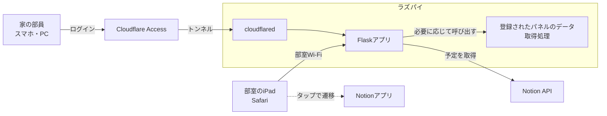

# 部室ダッシュボード 仕様書

作成：2026年10月4日 · @しーたけ

更新：2026年10月12日

## 1. 概要

岡山大学DS部の部室に置いたiPadに常時表示する、Webのダッシュボードを開発します。画面の左側にNotionのカレンダー、右側に時計と機能ごとの「パネル」を並べます。

**この仕様書の使い方**：この仕様書は、コーディングエージェントがこれだけを読んでダッシュボードの共通部分を実装できるように書いています。書かれていないことは第2章の設計方針に従って最も単純な方法を選び、第15章の未決事項は設定値として後から変えられるようにしてください。

**個別機能との境界**：水耕栽培などの個別パネルについては、表示内容、データの取得・収集・保存、判定処理をそれぞれの機能の仕様書で定義します。本書は、パネルを表示・更新する共通の仕組みと、追加する際の約束（第7章）を定義します。個別パネルがなくても、ダッシュボード単体で起動・運用できるようにしてください。

- **目的**：部員が毎日使うプロダクトを部として運用する。初心者の部員がパネルを追加しながら開発を学べるようにする。
- **今回実装するもの**：画面の土台、時計、夜間表示、スマホ向けの表示、Notionカレンダー（月表示）、パネルの追加・定期更新・エラー表示の仕組み、家から見られるようにする外部公開の設定（Cloudflare Tunnel＋Access）
- **今回実装しないもの**：個別パネルの機能、呼び出しボタン、アプリ内のログイン機能（認証はCloudflare Accessが行う）、Notionへの書き込み

| 利用者 | 使い方 |
| --- | --- |
| 部室にいる部員 | iPadで予定と、登録されたパネルの情報を見る。タップしてNotionや、用意されている詳細画面を開く |
| 家など部室の外にいる部員 | スマホやPCのブラウザで同じ画面を見る。許可されたメールアドレスでログインした部員だけが見られる |
| 開発担当の部員（初心者が中心） | ダッシュボードを保守し、別の仕様書に沿ってパネルを追加する。AIを使って開発する |

## 2. 設計方針

保守するのはプログラミング初心者が中心の部員です。**機能の豊富さより、初心者が読んで理解できることを最優先**にしてください。部員はPythonにはある程度慣れていますが、Web開発の経験は少ない想定です。

1. **言語はPythonを中心にする**：サーバーとNotion連携はPythonで書く。画面はHTML・CSSと、必要最小限の素のJavaScriptで書く。
2. **ビルド作業を使わない**：React・Vue・TypeScript・npm・バンドラーは使わない。JavaScriptのライブラリはCDNの`<script>`タグで読み込む。
3. **外部サービスを増やさない**：ダッシュボードのためのクラウドDBやホスティングは使わず、Webサーバーはラズパイ1台で動かす。共通部分が外部と通信するのはNotion API、CDN、家から見るためのCloudflareだけ。個別パネルに必要な連携先は、その機能の仕様書で定義する。
4. **共通部分にDBを持たせない**：予定の元データはNotionに置き、取得結果はメモリに一時保存する。個別パネルのデータ保存方式は、その機能の仕様書で定義する。
5. **設定は1か所にまとめる**：秘密情報は`.env`、それ以外の設定は`config.py`に置き、コード中に値を直接書かない。
6. **追加の仕方を決めておく**：パネルは、データ取得用のPythonファイルと表示用テンプレートを用意し、`app.py`にAPIを追加して`PANELS`に登録する形にする。手順はREADMEに書く。自動検出やプラグイン管理の仕組みは作らない。
7. **説明を日本語で残す**：各ファイルの先頭に「このファイルの役割」を日本語のコメントで書く。分かりにくい処理にも日本語でコメントを付ける。
8. **簡単さを優先する**：高度な書き方（メタプログラミング、過度な抽象化、非同期処理など）より、長くても素直な書き方を選ぶ。

## 3. システム構成

部室に置くラズパイ1台でWebサーバーを動かします。部室のiPadは部室専用Wi-Fiから直接、家にいる部員はCloudflareを経由してラズパイにアクセスします。ラズパイからCloudflareへ外向きに接続するだけなので、ルーターのポート開放は不要です。



| 要素 | 採用技術 | 役割 |
| --- | --- | --- |
| ハードウェア | Raspberry Pi（Raspberry Pi OS、機種は未定） | Webサーバーを実行 |
| 言語 | Python 3.11以上 | サーバー、Notion連携、パネルのAPI |
| Webフレームワーク | Flask（画面はJinja2テンプレート） | 画面とJSON APIの提供 |
| 本番用サーバー | waitress | ラズパイ上でFlaskを動かす |
| Notion連携 | 公式Python SDK `notion-client` | カレンダーの予定を取得 |
| 設定 | `python-dotenv` | `.env`から秘密情報を読む |
| カレンダー表示 | FullCalendar（CDN） | 月表示のカレンダー |
| 自動起動 | systemd | ラズパイの起動時にWebサーバーを立ち上げる |
| 外部公開 | Cloudflare Tunnel（`cloudflared`） | 家からのアクセスを部室のラズパイに届ける。トンネルはCloudflareの管理画面で作り、ラズパイにはサービスとして入れる |
| 認証 | Cloudflare Access | 許可したメールアドレスに届くコードでログインさせる。アプリ側の実装は不要 |

開発は各自のWindows・Macで行います。ラズパイや個別パネルがなくても起動できるようにします。Notionの設定がない場合は、空のカレンダーと「Notionが未設定です」の案内を表示します。

## 4. 画面構成

画面は左右に分け、左にNotionカレンダー、右に時計と縦に並ぶ3つのパネル枠を置きます。初期状態では3つとも「準備中」です。各枠に何を表示するかは設定で決めます。iPadの横向き表示を前提にします。

```text
+--------------------------------+----------------------+
|                                |  10/4(日) 14:32       |
|                                +----------------------+
|   Notionカレンダー (月表示)       |  枠1: 準備中           |
|                                |                      |
|   タップでNotionアプリを開く      +----------------------+
|                                |  枠2: 準備中           |
|                                +----------------------+
|                                |  枠3: 準備中           |
+--------------------------------+----------------------+
             左 約60%                      右 約40%
```

| 画面 | URL | 内容 | 必須か |
| --- | --- | --- | --- |
| ダッシュボード | `/` | 上図の画面。iPadに常時表示する | 必須 |
| 各パネルの詳細 | `/panels/<パネルID>` | 個別機能の仕様で必要とされた場合に追加する。共通の操作要件はC-3・C-8に従う | 任意 |

- 左右の幅の比率はCSSの変数で変えられるようにする。
- iPadの横向きでは、画面全体がスクロールせず1画面に収まるようにする。
- 幅が狭い縦長の画面（家からスマホで見る場合）では、カレンダーを上、パネルを下に縦に並べ、スクロールで見られるようにする（CSSのメディアクエリで切り替える）。
- 離れた場所からも読めるように、文字は大きめにし、背景と文字のコントラストをはっきりさせる。

## 5. 機能要件：共通

土台となる画面と、パネルを差し込む仕組みの要件です。

| ID | 要件 | 必須か |
| --- | --- | --- |
| C-1 | 右側の3つの枠に何を表示するかは、`config.py`の`PANELS`リストで決める。値が`None`の枠は「準備中」と表示する | 必須 |
| C-2 | 1つのパネルは「表示用テンプレート`templates/panels/<パネルID>.html`」と「データ取得API`/api/panels/<パネルID>`」の組で作る。追加方法とAPIの約束は第7章に従う | 必須 |
| C-3 | `PANELS`の各要素に詳細画面のURLがあれば、そのパネルをタップすると詳細画面へ移動する。なければタップしても何も起きない | 任意 |
| C-4 | 右上に日付と時刻を表示し、1分ごとに更新する | 必須 |
| C-5 | ページ全体は再読み込みせず、JavaScriptの`fetch`で各パネルとカレンダーのデータを定期的に取り直す（パネル：1分ごと、カレンダー：10分ごと） | 必須 |
| C-6 | データの取得に失敗したら、前回の表示を残したまま「最終更新 14:30」のように最後に成功した時刻を出す。パネルで一度も取得に成功していなければ「データを取得できません」と表示する。1つのパネルの失敗はほかのパネルに影響させない。次に取得できたらエラー表示を消す | 必須 |
| C-7 | 夜間（初期値 22:00〜7:00、設定で変更可）は、背景を黒にして時計だけを表示する「夜間表示」に自動で切り替える | 必須 |
| C-8 | 詳細画面には「戻る」ボタンを置く。操作がないまま3分たったら自動でダッシュボードに戻る | 詳細画面を作る場合は必須 |
| C-9 | 幅が狭い縦長の画面（スマホ）では、カレンダーを上、パネルを下に縦に並べて表示する（第4章） | 必須 |

APIの一覧です。すべてJSONを返します。

| メソッドとURL | 内容 | 必須か |
| --- | --- | --- |
| `GET /api/calendar?start=YYYY-MM-DD&end=YYYY-MM-DD` | 期間内の予定（第6章） | 必須 |
| `GET /api/panels/<パネルID>` | 登録されたパネルの表示用データ（第7章） | パネルを追加する場合は必須 |

個別パネル専用の追加APIは、その機能の仕様書で定義します。未登録のパネル用APIを先に作る必要はありません。

## 6. 機能要件：Notionカレンダー

部内Notionのカレンダー用データベースから1か月分の予定を取得し、画面の左側に月表示で出します。カレンダーをタップするとNotionアプリで同じカレンダーを開きます。

| ID | 要件 | 必須か |
| --- | --- | --- |
| N-1 | FullCalendarの月表示（`dayGridMonth`）で今月を表示する。日本語表示（`locale: 'ja'`）、タイムゾーンは日本時間。今日の日付を強調する | 必須 |
| N-2 | 前月・翌月への移動ボタンは置かず、「2026年10月」のような見出しだけを出す。月が変わったら自動で新しい月を表示する | 必須 |
| N-3 | 予定は`GET /api/calendar`から取得する。FullCalendarが渡す表示期間（`start`・`end`）をそのままAPIに渡す | 必須 |
| N-4 | APIはサーバー側でNotion APIを呼び、日付プロパティが表示期間に重なる予定を取得する。1回の取得上限（100件）を超えたら続きも取得する | 必須 |
| N-5 | APIは予定をFullCalendarの形（`title`、`start`、`end`、`allDay`）のJSON配列で返す。終日の予定は、Notionの終了日（その日を含む）をFullCalendarの終了日（その日を含まない）に合わせて1日後ろにずらす | 必須 |
| N-6 | タイトルと日付のプロパティ名は設定で変えられるようにする（第10章） | 必須 |
| N-7 | 1日に予定が多いときは「他 2件」のように省略表示する（FullCalendarの`dayMaxEvents`） | 必須 |
| N-8 | サーバーは取得結果を5分間メモリに保存し、その間はNotion APIを呼ばない。Notionからの取得に失敗したら、最後に成功した結果を返す | 必須 |
| N-9 | カレンダーの領域をタップすると、設定`NOTION_CALENDAR_OPEN_URL`のURLを開いてNotionアプリに遷移する | 必須 |

実装上の注意：

- Notionのトークンは`.env`に置き、ブラウザには渡さない。Notionの連携（インテグレーション）は、読み取り権限だけでカレンダーのデータベースにだけ接続する。
- Notion APIの呼び出し方法は、実装時に公式ドキュメントと使用する`notion-client`のバージョンで確認してください。データベースIDから予定を取得するまでの処理は`notion_calendar.py`にまとめ、ブラウザ側にAPIの詳細を持たせないでください。
- iPadで`https://www.notion.so/...`のURLを開くと、NotionアプリではなくSafariで開く場合があります。そのときは`notion://www.notion.so/...`の形を設定します。どちらでも動くよう、URLはコードで加工せず設定値をそのまま使ってください。

## 7. パネルを追加する際の約束

この章は、別の仕様書で開発する機能をダッシュボードに載せるための共通ルールです。パネルの中で何を表示するか、どこからデータを取得するか、どの条件で警告するかは、各機能の仕様書で定義します。

### パネルの登録

パネルIDは英小文字とアンダースコア（`_`）で付けます。1つのIDは1つの枠に登録します。追加するものは次の4つです。

| 追加・変更するもの | 役割 |
| --- | --- |
| `panels/<パネルID>.py` | `get_data()`関数で表示用データを辞書として返す |
| `app.py`のimport文とAPIルート | `GET /api/panels/<パネルID>`で`get_data()`の結果をJSONとして返す |
| `templates/panels/<パネルID>.html` | パネルの中身と、受け取ったJSONを表示する関数を用意する |
| `config.py`の`PANELS` | 表示する枠にパネルID・タイトル・必要に応じて詳細画面のURLを登録する |

`PANELS`は上から枠1・枠2・枠3の順で、3要素のリストにします。各要素は`None`または次の辞書です。

```python
{"id": "message", "title": "お知らせ"}
# 詳細画面がある場合
{"id": "message", "title": "お知らせ", "detail_url": "/panels/message"}
```

`id`と`title`は必須、`detail_url`は任意です。詳細画面を付ける場合は、対応する画面のルートとテンプレートも追加し、C-8の「戻る」ボタンと自動復帰に対応します。詳細画面の内容は各機能の仕様書で定義します。

### APIと表示の約束

- 共通の更新処理は、登録されたパネルのAPIをページ表示時と`PANEL_REFRESH_SECONDS`ごとに呼びます。「準備中」の枠ではAPIを呼びません。
- 成功時はHTTP 200でJSONオブジェクトを返します。JSONの項目名と値の意味は各機能の仕様書で定義し、そのパネルの表示関数だけが解釈します。共通部分は個別のデータ項目を参照しません。
- 取得に失敗した場合は、HTTP 500や502などのエラーステータスと、`{"error": "表示用データを取得できませんでした"}`のようなJSONを返します。詳しい原因はサーバーのログに記録し、秘密情報を応答に含めません。共通部分はHTTPステータスで取得失敗を判定します。
- 表示用テンプレートは`registerPanel("<パネルID>", function (body, data) { ... })`で表示関数を登録します。`body`はそのパネルの中身の要素、`data`はAPIが返したJSONです。
- タイトル、更新状況、詳細画面への遷移は共通の外枠が担当します。表示関数は渡された`body`の中だけを書き換え、ほかの枠や時計に影響させません。
- APIから受け取った文字列は`textContent`で表示します。`innerHTML`にそのまま入れないでください。
- 共通部分の「最終更新」は、ブラウザが最後にAPIの取得と表示に成功した時刻です。元データの計測時刻や鮮度とは区別し、必要な場合は個別パネルの表示用データと表示関数で扱います。

次は、追加方法を説明するための「お知らせ」パネルの例です。このパネルを初期状態で登録する必要はありません。

```python
# panels/message.py
# このファイルの役割：お知らせパネルの表示用データを作ります。
def get_data():
    return {"text": "部室の鍵は18時までに返却してください"}
```

```python
# app.pyのimport文に追加
from panels import message

# app.pyのAPIルートに追加
@app.route("/api/panels/message")
def api_panel_message():
    try:
        return jsonify(message.get_data())
    except Exception:
        app.logger.exception("お知らせパネルのデータ取得に失敗しました")
        return jsonify({"error": "表示用データを取得できませんでした"}), 502
```

```html
{# templates/panels/message.html #}
{# このファイルの役割：お知らせパネルの表示部分です。 #}
<p class="message-text"></p>
<script>
  registerPanel("message", function (body, data) {
    body.querySelector(".message-text").textContent = data.text;
  });
</script>
```

共通の`dashboard.js`は、パネルのテンプレートが`registerPanel`を呼ぶより前に読み込んでください。追加後は`PANELS`の表示したい枠を上の辞書に置き換え、サーバーを再起動して画面を再読み込みします。

## 8. 個別機能の仕様書との分担

個別機能を追加するときは、その機能の仕様書で次の内容を決め、第7章の約束に沿って接続してください。

1. パネルID、タイトル、表示する内容
2. 表示用APIのJSONの項目名と意味
3. 元データの取得・保存方法と、必要な設定・依存ライブラリ
4. 詳細画面や追加APIの有無と、その内容
5. 機能固有の警告条件、運用手順、完了条件

共通の画面配置・定期更新・エラー表示・認証の要件は本書を参照し、個別機能の仕様書に重複して定義しないでください。定期収集などWebサーバー以外の処理が必要な場合は、その実行方法も個別機能側で定義します。

呼び出しボタンを含め、まだ仕様が決まっていない機能のためのコード、テーブル、画面は先に作らないでください。

## 9. データの扱い

ダッシュボードの共通部分にはDBを用意しません。データと状態は次のように扱います。

| データ・状態 | 置き場所 | 扱い |
| --- | --- | --- |
| カレンダーの元データ | Notion | ダッシュボードからは読み取るだけで、書き込まない |
| カレンダーの取得結果 | サーバーのメモリ | 表示期間ごとに結果と取得時刻を保存する。キャッシュ期限内は再取得せず、取得失敗時は同じ期間の前回の結果を使う（N-8） |
| パネルの表示用データ | 各パネルのAPI | 形式と元データの取得・保存は各機能の仕様書で定義する |
| 画面の前回の表示・最後に成功した時刻 | ブラウザのメモリ | 取得失敗時の表示継続に使う。ページを開き直したら初期化する |
| 設定 | `config.py`と`.env` | 第10章に従う |
| ログ | `logs/` | 第12章に従う。Gitの管理対象外にする |

キャッシュはサーバー再起動時に失われて構いません。ブラウザの`localStorage`などに画面の状態を保存せず、URLを開き直すたびに現在の設定・日時・APIの応答から表示を組み立てます。

## 10. 設定値

秘密情報と環境ごとに違う値は`.env`、それ以外は`config.py`に置きます。`.env`はGitに含めず、代わりに説明付きの`.env.example`をリポジトリに入れます。

| 置き場所 | 名前 | 初期値 | 内容 |
| --- | --- | --- | --- |
| `.env` | `NOTION_TOKEN` | — | Notion連携のトークン |
| `.env` | `NOTION_DATABASE_ID` | — | カレンダーのデータベースID |
| `.env` | `NOTION_CALENDAR_OPEN_URL` | — | カレンダーをタップしたときに開くURL |
| `config.py` | `PANELS` | 下の例 | 右側の枠に表示するパネル |
| `config.py` | `NOTION_TITLE_PROPERTY` | `"名前"` | 予定のタイトルのプロパティ名 |
| `config.py` | `NOTION_DATE_PROPERTY` | `"日付"` | 予定の日付のプロパティ名 |
| `config.py` | `NIGHT_START` / `NIGHT_END` | `"22:00"` / `"07:00"` | 夜間表示にする時間帯 |
| `config.py` | `PANEL_REFRESH_SECONDS` | `60` | パネルのデータを取り直す間隔（秒） |
| `config.py` | `CALENDAR_REFRESH_SECONDS` | `600` | カレンダーを取り直す間隔（秒） |
| `config.py` | `CALENDAR_CACHE_SECONDS` | `300` | サーバーがNotionの結果を使い回す時間（秒） |
| `config.py` | `DETAIL_IDLE_SECONDS` | `180` | 詳細画面から自動で戻るまでの秒数 |
| `config.py` | `TIMEZONE` | `"Asia/Tokyo"` | タイムゾーン |
| `config.py` | `PORT` | `8000` | Webサーバーのポート番号 |
| `config.py` | `LOG_DIR` | アプリのルート直下の`logs/` | ログファイルの置き場所 |

```python
# config.py の PANELS の初期値（上から枠1・枠2・枠3）
PANELS = [
    None,  # 準備中
    None,  # 準備中
    None,  # 準備中
]
```

個別パネルに固有の設定名と初期値は、その機能の仕様書で定義します。同じアプリに追加する場合は、秘密情報は`.env`、それ以外は`config.py`にまとめる方針に従ってください。

## 11. ディレクトリ構成

ファイルを役割ごとに分け、初心者が「どこを触ればよいか」を判断しやすい構成にします。大きく変える場合は、理由をREADMEに書いてください。

```text
bushitsu-dashboard/
├── README.md                 # セットアップ手順、パネルの追加方法
├── requirements.txt
├── .env.example
├── .gitignore                # .env, .venv/, logs/ を除外
├── config.py                 # 設定値
├── app.py                    # Flaskアプリ。画面とAPIのURLをここに並べる
├── notion_calendar.py        # Notionから予定を取得し、FullCalendarの形に変換
├── panels/
│   ├── __init__.py
│   └── <パネルID>.py         # パネル追加時に作る：表示用データを返す
├── templates/
│   ├── base.html
│   ├── index.html            # ダッシュボード
│   ├── <パネルID>_detail.html # 詳細画面が必要な場合に追加する
│   └── panels/
│       ├── <パネルID>.html   # パネル追加時に作る：パネルの表示部分
│       └── empty.html        # 「準備中」の枠
├── static/
│   ├── style.css
│   ├── dashboard.js          # 時計、パネルの定期更新、夜間表示
│   └── calendar.js           # カレンダーの表示、定期更新、Notionへの遷移
├── deploy/
│   └── dashboard.service     # ラズパイで自動起動するためのsystemd設定
├── tests/                    # pytestのテスト
└── logs/                     # ログ（Git管理外）
```

`<パネルID>`のファイルは、実際にパネルを追加する際に作ります。共通部分の実装だけで個別パネル用のファイルを作る必要はありません。コマンドは`bushitsu-dashboard/`を作業ディレクトリとして実行します（例：`python app.py`）。

## 12. 非機能要件

| 区分 | 要件 |
| --- | --- |
| 公開範囲 | 部室のiPadは部室専用Wi-Fiから直接見る。家からはCloudflare Tunnel経由で見られるようにし、Cloudflare Accessで許可したメールアドレスの部員だけが閲覧できるようにする。アプリ側にはログイン機能を作らない |
| 認証なし公開の禁止 | 外部からのURLは必ずCloudflare Accessで保護する。ルーターのポート開放や、認証なしの一時的な公開URLは使わない |
| 秘密情報 | Notionのトークンは`.env`だけに、cloudflaredのトークンはラズパイのサービス設定だけに置き、リポジトリ、ログ、ブラウザに出さない |
| 対応端末 | iPadのSafari（横向き、最新のiPadOS）に加え、スマホ（iPhone・Android）のブラウザでも崩れずに見られる。開発はWindows・Mac、本番はRaspberry Pi OS |
| 自動起動 | Webサーバーとcloudflaredが、ラズパイの起動時に自動で立ち上がり、落ちたときは自動で再起動する（systemdの`Restart=always`） |
| アクセス先 | Webサーバーはポート8000番で待ち受ける。部室からは`http://<ラズパイのホスト名>.local:8000/`、家からはCloudflareで設定したURL（例：`https://dashboard.<ドメイン>/`） |
| ログ | Python標準の`logging`で`logs/`に出す。ファイルが大きくなりすぎないように`RotatingFileHandler`を使う |
| 依存関係 | `requirements.txt`はバージョンを固定する。CDNのライブラリもURLでバージョンを固定する |
| テスト | Notionの予定の変換（特に終日予定の終了日・期間の重なり）と、カレンダーAPIの入力・失敗時の処理についてpytestで確認する。画面の配置、夜間表示、パネルの独立した更新と取得失敗時の表示はブラウザで確認する |

READMEには次の内容を、初心者がそのまま真似できる手順として書いてください。

1. 自分のPCでの起動方法（仮想環境の作成から、Notion未設定でも画面を表示できるところまで）
2. Notion連携の準備（インテグレーション作成、データベースへの接続、IDの調べ方）
3. ラズパイへの設置手順（waitressとsystemdの設定を含む）
4. 家から見られるようにする設定（Cloudflare Tunnelの作成とcloudflaredの導入、Cloudflare Accessで許可するメールアドレスの追加・削除）
5. パネルの追加方法
6. 詳細画面を付ける場合の共通ルール（戻るボタンと自動復帰）
7. よくあるトラブルと対処（画面が更新されない、予定が出ない、家から開けない、など）

## 13. 実装の順番と完了条件

次の順に実装し、各ステップの完了条件を満たしてから次へ進んでください。ステップごとにプルリクエストを分けると、部員がレビューしやすくなります。

| ステップ | 内容 | 完了条件 |
| --- | --- | --- |
| 1. 土台 | Flaskアプリ、左右分割の画面、時計、「準備中」の枠、夜間表示、スマホ向けの縦並び（C-1、C-2、C-4、C-5、C-7、C-9） | 自分のPCで起動すると、左に空のカレンダー領域、右に「準備中」の枠が3つ表示され、時計が進む。夜間の時間帯を今の時刻に変えると夜間表示になる。ブラウザの幅を狭くすると縦並びになる |
| 2. カレンダー | Notionからの取得と月表示、タップでの遷移（N-1〜N-9） | 今月の予定が表示され、複数日にまたがる終日予定が正しい日数で出る。タップで設定したURLが開く。ネットを切っても表示が消えない |
| 3. パネル追加の確認 | 第7章の追加手順と、共通の更新・エラー表示の確認（C-2、C-5、C-6）。開発用に簡単な表示用データを使う | 個別の機器やDBなしでパネルを追加できる。2つのパネルを使い、一方の取得を失敗させても前回の表示が残り、もう一方は更新される。初回失敗時には案内が出て、取得できるようになるとエラー表示が消える。確認後の初期設定は3枠とも`None`にする |
| 4. ラズパイへの設置 | waitressとsystemdの設定、READMEの仕上げ | ラズパイを再起動してもWebサーバーが自動で立ち上がり、部室のiPadでダッシュボードを開ける |
| 5. 外部公開 | Cloudflare TunnelとAccessの設定、READMEへの手順追加。大学の規程の確認とドメインの用意が済んでから行う | 家のスマホから、許可したメールアドレスでログインするとダッシュボードが見られる。許可していないアドレスでは見られない |
| 6. 詳細画面への対応（任意） | 詳細画面への遷移と共通の復帰動作（C-3、C-8）。確認用の簡単な画面を使う | `detail_url`を持つパネルから詳細画面を開ける。「戻る」でダッシュボードに戻り、3分操作しなくても自動で戻る。URLがないパネルはタップしても遷移しない |

ステップ3と6で使うパネル・画面は、共通の仕組みを確認するためのものです。個別機能の実装や、その機能の完了条件は各機能の仕様書で扱います。

## 14. iPadの運用（参考・実装対象外）

iPadの設定は部員が手で行います。画面を作るときの前提として読んでください。iPadは日中ほかの用途にも使うため、ダッシュボード以外のアプリが開かれていることがあります。

- ダッシュボードはホーム画面に追加して全画面で開く。アクセスガイドは使わない。
- 自動ロックは「なし」にする。
- 「ショートカット」の自動化で、朝7:00に明るさを戻してダッシュボードのURLを開き、夜22:00に明るさを最低にする。朝の自動化が、前日の戻し忘れの解消とページの再読み込みを兼ねる。

このため画面側は、「URLを開き直すだけで必ず正しい状態に戻る」ように作ってください（ブラウザに状態を保存しない）。

## 15. 未決事項

次の点はまだ決まっていません。実装では初期値を仮に入れ、設定を変えるだけで対応できるようにしてください。

| 項目 | 仮の扱い |
| --- | --- |
| ラズパイの機種 | Raspberry Pi OSでPython 3.11以上が動くことだけを前提にする |
| Notionのプロパティ名 | `名前`と`日付`を仮に使う（第10章） |
| タップ時に開くURLの形式 | `https://`と`notion://`のどちらでも設定できるようにする（第6章） |
| 夜間表示の時間帯 | 22:00〜7:00 |
| 左右の幅の比率 | 左60%・右40% |
| 各枠に入れるパネル | 初期状態は3枠とも「準備中」。各機能の準備ができたら`PANELS`に登録する |
| 大学ネットワークの規程 | 学内から外部公開してよいかの確認が済むまで、ステップ5は行わない |
| 外部公開に使うドメイン | 未取得。用意できるまでステップ5は保留 |
| 閲覧を許可するメールアドレス | 部員の大学のメールアドレスを想定 |
