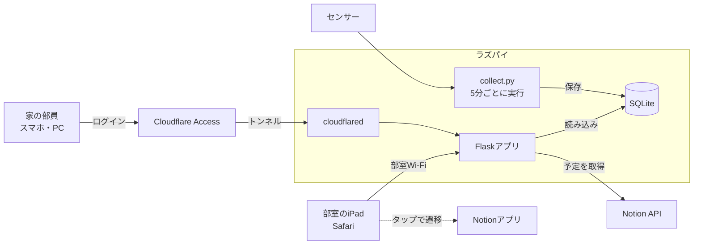

# 部室ダッシュボード 仕様書

Oct 4, 2026 · @しーたけ

## 1. 概要

岡山大学DS部の部室に置いたiPadに常時表示する、Webのダッシュボードを開発します。画面の左半分にNotionのカレンダー、右半分に機能ごとの「パネル」を並べます。

**この仕様書の使い方**：この仕様書は、コーディングエージェントがこれだけを読んで実装できるように書いています。書かれていないことは第2章の設計方針に従って最も単純な方法を選び、第15章の未決事項は設定値として後から変えられるようにしてください。

- **目的**：部員が毎日使うプロダクトを部として運用する。初心者の部員がパネルを追加しながら開発を学べるようにする。
- **今回実装するもの**：画面の土台、Notionカレンダー（月表示）、水耕栽培パネル、センサー値の収集の仕組み（開発用のダミーセンサー付き）、家から見られるようにする外部公開の設定（Cloudflare Tunnel＋Access）
- **今回実装しないもの**：呼び出しボタン、実際のセンサーのドライバー、アプリ内のログイン機能（認証はCloudflare Accessが行う）、Notionへの書き込み

| 利用者 | 使い方 |
| --- | --- |
| 部室にいる部員 | iPadで予定と水耕栽培の状態を見る。タップしてNotionや詳細画面を開く |
| 家など部室の外にいる部員 | スマホやPCのブラウザで同じ画面を見る。許可されたメールアドレスでログインした部員だけが見られる |
| 開発担当の部員（初心者が中心） | パネルやセンサーを追加・保守する。AIを使って開発する |

## 2. 設計方針

保守するのはプログラミング初心者が中心の部員です。**機能の豊富さより、初心者が読んで理解できることを最優先**にしてください。部員はPythonにはある程度慣れていますが、Web開発の経験は少ない想定です。

1. **言語はPythonを中心にする**：サーバー、センサー収集、Notion連携はすべてPythonで書く。画面はHTML・CSSと、必要最小限の素のJavaScriptで書く。
2. **ビルド作業を使わない**：React・Vue・TypeScript・npm・バンドラーは使わない。JavaScriptのライブラリはCDNの`<script>`タグで読み込む。
3. **外部サービスを増やさない**：クラウドのDBやホスティングは使わず、ラズパイ1台で完結させる。外部と通信するのはNotion API、CDN、家から見るためのCloudflareだけ。
4. **DBはSQLite、テーブルは最小限**：ORMは使わず、標準ライブラリの`sqlite3`でSQLを書く。
5. **設定は1か所にまとめる**：秘密情報は`.env`、それ以外の設定は`config.py`に置き、コード中に値を直接書かない。
6. **追加の仕方を決めておく**：パネルとセンサーは、ファイルを追加して設定に1行書くだけで増やせる形にする。手順はREADMEに書く。
7. **説明を日本語で残す**：各ファイルの先頭に「このファイルの役割」を日本語のコメントで書く。分かりにくい処理にも日本語でコメントを付ける。
8. **簡単さを優先する**：高度な書き方（メタプログラミング、過度な抽象化、非同期処理など）より、長くても素直な書き方を選ぶ。

## 3. システム構成

部室に置くラズパイ1台が、Webサーバー・センサー収集・DBをすべて担います。部室のiPadは部室専用Wi-Fiから直接、家にいる部員はCloudflareを経由してラズパイにアクセスします。ラズパイからCloudflareへ外向きに接続するだけなので、ルーターのポート開放は不要です。



| 要素 | 採用技術 | 役割 |
| --- | --- | --- |
| ハードウェア | Raspberry Pi（Raspberry Pi OS、機種は未定） | すべての処理を実行 |
| 言語 | Python 3.11以上 | サーバー、収集、Notion連携 |
| Webフレームワーク | Flask（画面はJinja2テンプレート） | 画面とJSON APIの提供 |
| 本番用サーバー | waitress | ラズパイ上でFlaskを動かす |
| DB | SQLite（標準ライブラリ`sqlite3`） | センサー値の保存 |
| Notion連携 | 公式Python SDK `notion-client` | カレンダーの予定を取得 |
| 設定 | `python-dotenv` | `.env`から秘密情報を読む |
| カレンダー表示 | FullCalendar（CDN） | 月表示のカレンダー |
| グラフ | Chart.js（CDN） | センサー値のグラフ |
| 定期実行 | cron | センサー値の収集を5分ごとに実行 |
| 自動起動 | systemd | ラズパイの起動時にWebサーバーを立ち上げる |
| 外部公開 | Cloudflare Tunnel（`cloudflared`） | 家からのアクセスを部室のラズパイに届ける。トンネルはCloudflareの管理画面で作り、ラズパイにはサービスとして入れる |
| 認証 | Cloudflare Access | 許可したメールアドレスに届くコードでログインさせる。アプリ側の実装は不要 |

開発は各自のWindows・Macで行います。そのため、ラズパイやセンサーがなくても、ダミーセンサーで全機能を動かせるようにします。

## 4. 画面構成

画面は左右に分け、左にNotionカレンダー、右に縦に並ぶ3つのパネル枠を置きます。枠1は水耕栽培、枠2と3は「準備中」です。iPadの横向き表示を前提にします。

```text
+--------------------------------+----------------------+
|                                |  10/4(日) 14:32       |
|                                +----------------------+
|   Notionカレンダー (月表示)       |  枠1: 水耕栽培         |
|                                |  (タップで詳細画面)   |
|   タップでNotionアプリを開く      +----------------------+
|                                |  枠2: 準備中           |
|                                +----------------------+
|                                |  枠3: 準備中           |
+--------------------------------+----------------------+
             左 約60%                      右 約40%
```

| 画面 | URL | 内容 | 必須か |
| --- | --- | --- | --- |
| ダッシュボード | `/` | 上図の画面。iPadに常時表示する | 必須 |
| 水耕栽培の詳細 | `/panels/hydroponics` | 水耕栽培パネルをタップしたときの詳細画面（第7章） | 任意 |

- 左右の幅の比率はCSSの変数で変えられるようにする。
- iPadの横向きでは、画面全体がスクロールせず1画面に収まるようにする。
- 幅が狭い縦長の画面（家からスマホで見る場合）では、カレンダーを上、パネルを下に縦に並べ、スクロールで見られるようにする（CSSのメディアクエリで切り替える）。
- 離れた場所からも読めるように、文字は大きめにし、背景と文字のコントラストをはっきりさせる。

## 5. 機能要件：共通

土台となる画面と、パネルを差し込む仕組みの要件です。

| ID | 要件 | 必須か |
| --- | --- | --- |
| C-1 | 右側の3つの枠に何を表示するかは、`config.py`の`PANELS`リストで決める。値が`None`の枠は「準備中」と表示する | 必須 |
| C-2 | 1つのパネルは「表示用テンプレート`templates/panels/<パネルID>.html`」と「データ取得API`/api/panels/<パネルID>`」の組で作る。新しいパネルはこの2つを追加して`PANELS`に登録するだけで表示できる | 必須 |
| C-3 | `PANELS`の各要素に詳細画面のURLがあれば、そのパネルをタップすると詳細画面へ移動する。なければタップしても何も起きない | 任意 |
| C-4 | 右上に日付と時刻を表示し、1分ごとに更新する | 必須 |
| C-5 | ページ全体は再読み込みせず、JavaScriptの`fetch`で各パネルとカレンダーのデータを定期的に取り直す（パネル：1分ごと、カレンダー：10分ごと） | 必須 |
| C-6 | データの取得に失敗したら、前回の表示を残したまま「最終更新 14:30」のように最後に成功した時刻を出す。1つのパネルの失敗はほかのパネルに影響させない | 必須 |
| C-7 | 夜間（初期値 22:00〜7:00、設定で変更可）は、背景を黒にして時計だけを表示する「夜間表示」に自動で切り替える | 必須 |
| C-8 | 詳細画面には「戻る」ボタンを置く。操作がないまま3分たったら自動でダッシュボードに戻る | 詳細画面を作る場合は必須 |
| C-9 | 幅が狭い縦長の画面（スマホ）では、カレンダーを上、パネルを下に縦に並べて表示する（第4章） | 必須 |

APIの一覧です。すべてJSONを返します（CSVを除く）。

| メソッドとURL | 内容 | 必須か |
| --- | --- | --- |
| `GET /api/calendar?start=YYYY-MM-DD&end=YYYY-MM-DD` | 期間内の予定（第6章） | 必須 |
| `GET /api/panels/hydroponics` | 各項目の最新値（第7章） | 必須 |
| `GET /api/sensors/history?metric=<項目名>&hours=24` | 指定した項目の履歴（第7章） | 任意 |
| `GET /api/sensors/export.csv` | 全計測値のCSV（第7章） | 任意 |

## 6. 機能要件：Notionカレンダー

部内Notionのカレンダー用データベースから1か月分の予定を取得し、画面の左側に月表示で出します。カレンダーをタップするとNotionアプリで同じカレンダーを開きます。

| ID | 要件 | 必須か |
| --- | --- | --- |
| N-1 | FullCalendarの月表示（`dayGridMonth`）で今月を表示する。日本語表示（`locale: 'ja'`）、タイムゾーンは日本時間。今日の日付を強調する | 必須 |
| N-2 | 前月・翌月への移動ボタンは置かず、「2026年10月」のような見出しだけを出す。月が変わったら自動で新しい月を表示する | 必須 |
| N-3 | 予定は`GET /api/calendar`から取得する。FullCalendarが渡す表示期間（`start`・`end`）をそのままAPIに渡す | 必須 |
| N-4 | APIはサーバー側でNotion APIを呼び、日付プロパティが表示期間に重なる予定を取得する。1回の取得上限（100件）を超えたら続きも取得する | 必須 |
| N-5 | APIは予定をFullCalendarの形（`title`、`start`、`end`、`allDay`）のJSON配列で返す。終日の予定は、Notionの終了日（その日を含む）をFullCalendarの終了日（その日を含まない）に合わせて1日後ろにずらす | 必須 |
| N-6 | タイトルと日付のプロパティ名は設定で変えられるようにする（第10章） | 必須 |
| N-7 | 1日に予定が多いときは「他 2件」のように省略表示する（FullCalendarの`dayMaxEvents`） | 必須 |
| N-8 | サーバーは取得結果を5分間メモリに保存し、その間はNotion APIを呼ばない。Notionからの取得に失敗したら、最後に成功した結果を返す | 必須 |
| N-9 | カレンダーの領域をタップすると、設定`NOTION_CALENDAR_OPEN_URL`のURLを開いてNotionアプリに遷移する | 必須 |

実装上の注意：

- Notionのトークンは`.env`に置き、ブラウザには渡さない。Notionの連携（インテグレーション）は、読み取り権限だけでカレンダーのデータベースにだけ接続する。
- Notion APIは2025年にデータベースの取得方法が変わっています（「データソース」の導入）。実装前に公式ドキュメントと`notion-client`の最新版で、使うべきメソッドを確認してください。
- iPadで`https://www.notion.so/...`のURLを開くと、NotionアプリではなくSafariで開く場合があります。そのときは`notion://www.notion.so/...`の形を設定します。どちらでも動くよう、URLはコードで加工せず設定値をそのまま使ってください。

## 7. 機能要件：水耕栽培パネル

ラズパイにつないだセンサーの値を5分ごとに記録し、右側の枠1に最新の値を表示します。\*\*使うセンサーは未定です。\*\*特定のセンサーを前提にせず、「センサー1つ＝ファイル1つ」で後から追加できる形にしてください。今回は開発用のダミーセンサーだけを実装します。

### センサーの共通の形

各センサーは`collector/sensors/`に1ファイルで作り、`read()`関数を1つだけ持ちます。`read()`は計測した値のリストを返します。

```python
# collector/sensors/dummy.py の例
def read():
    return [
        {"metric": "air_temp", "label": "気温", "value": 24.3, "unit": "℃"},
        {"metric": "water_temp", "label": "水温", "value": 21.8, "unit": "℃"},
    ]
```

使うセンサーは`collector/sensors/__init__.py`に、import文とリストへの追加で明示的に書きます（自動検出はしない）。

### 要件

| ID | 要件 | 必須か |
| --- | --- | --- |
| H-1 | `collector/collect.py`は、登録された全センサーの`read()`を呼び、結果を同じ計測時刻でDBに保存して終了する。cronで5分ごとに実行する | 必須 |
| H-2 | 1つのセンサーでエラーが起きても、ログファイルに記録してほかのセンサーの保存は続ける | 必須 |
| H-3 | ダミーセンサーは、気温（20〜28℃）と水温（18〜24℃）をランダムに返す。開発環境で画面を確認するためのもの | 必須 |
| H-4 | 開発用に、ダミーデータを過去7日分まとめて入れるスクリプトを用意する | 必須 |
| H-5 | パネルには、DBにある項目ごとに「表示名・最新の値（小数点以下1桁）・単位」を並べる。項目はコードに書かず、DBの中身から決める（センサーを追加すれば自動で表示される） | 必須 |
| H-6 | 最後の計測時刻を表示する。30分以上新しい値がなければ「データが届いていません」と目立つ表示にする | 必須 |
| H-7 | `config.py`の`THRESHOLDS`に項目ごとの適正範囲を書くと、範囲外の値を赤色で表示する。範囲が未設定の項目は色を変えない | 任意 |
| H-8 | 詳細画面（`/panels/hydroponics`）で、項目ごとの折れ線グラフをChart.jsで表示する。期間は「24時間」「7日間」を切り替えられる | 任意 |
| H-9 | 詳細画面から全計測値をCSVでダウンロードできる | 任意 |

`GET /api/panels/hydroponics`の応答例です。

```json
{
  "measured_at": "2026-10-04T14:30:00+09:00",
  "stale": false,
  "items": [
    {"metric": "air_temp", "label": "気温", "value": 24.3, "unit": "℃", "out_of_range": false},
    {"metric": "water_temp", "label": "水温", "value": 21.8, "unit": "℃", "out_of_range": false}
  ]
}
```

## 8. 呼び出しボタン（概要のみ・今回は実装しない）

部室のある建物は夜に施錠されるため、外にいる部員がスマホから操作して部室内で音を鳴らし、中の人に知らせる機能です。将来、右側のパネル枠を使うか別の機能として追加する予定で、要件はまだ決まっていません。

家から見るために用意するCloudflare Tunnelは、この機能でスマホから部室のラズパイに届ける経路としても使える見込みです。

今回の実装ではこの機能のためのコード、テーブル、画面は作らないでください。

## 9. データ設計

DBはSQLiteのファイル1つ（`data/dashboard.db`）で、テーブルはセンサー値の1つだけです。予定はNotionから毎回取得するので保存しません。設定はDBではなく`config.py`と`.env`に置きます。

```sql
CREATE TABLE IF NOT EXISTS sensor_readings (
    id          INTEGER PRIMARY KEY AUTOINCREMENT,
    metric      TEXT NOT NULL,   -- 項目の識別名（例: water_temp）
    label       TEXT NOT NULL,   -- 画面に出す名前（例: 水温）
    value       REAL NOT NULL,   -- 計測値
    unit        TEXT NOT NULL,   -- 単位（例: ℃）
    measured_at TEXT NOT NULL    -- 計測時刻（日本時間のISO 8601。例: 2026-10-04T14:30:00+09:00）
);
CREATE INDEX IF NOT EXISTS idx_readings_metric_time
    ON sensor_readings (metric, measured_at);
```

- 「1行＝1項目の1回分の値」の形にする。センサーや項目が増えてもテーブルを変更しなくてよい。
- テーブルはサーバーと`collect.py`の起動時に上のSQLで自動作成する。
- 計測値は削除せず蓄積する。5分ごと・2項目なら1年で約21万行で、SQLiteで問題なく扱える。
- `data/`フォルダはGitの管理対象外にする。

## 10. 設定値

秘密情報と環境ごとに違う値は`.env`、それ以外は`config.py`に置きます。`.env`はGitに含めず、代わりに説明付きの`.env.example`をリポジトリに入れます。

| 置き場所 | 名前 | 初期値 | 内容 |
| --- | --- | --- | --- |
| `.env` | `NOTION_TOKEN` | — | Notion連携のトークン |
| `.env` | `NOTION_DATABASE_ID` | — | カレンダーのデータベースID |
| `.env` | `NOTION_CALENDAR_OPEN_URL` | — | カレンダーをタップしたときに開くURL |
| `config.py` | `PANELS` | 下の例 | 右側の枠に表示するパネル |
| `config.py` | `NOTION_TITLE_PROPERTY` | `"名前"` | 予定のタイトルのプロパティ名 |
| `config.py` | `NOTION_DATE_PROPERTY` | `"日付"` | 予定の日付のプロパティ名 |
| `config.py` | `NIGHT_START` / `NIGHT_END` | `"22:00"` / `"07:00"` | 夜間表示にする時間帯 |
| `config.py` | `PANEL_REFRESH_SECONDS` | `60` | パネルのデータを取り直す間隔（秒） |
| `config.py` | `CALENDAR_REFRESH_SECONDS` | `600` | カレンダーを取り直す間隔（秒） |
| `config.py` | `CALENDAR_CACHE_SECONDS` | `300` | サーバーがNotionの結果を使い回す時間（秒） |
| `config.py` | `STALE_MINUTES` | `30` | 「データが届いていません」と表示するまでの分数 |
| `config.py` | `THRESHOLDS` | `{}` | 項目ごとの適正範囲。例：`{"water_temp": (18, 26)}` |
| `config.py` | `DETAIL_IDLE_SECONDS` | `180` | 詳細画面から自動で戻るまでの秒数 |
| `config.py` | `DB_PATH` | `"data/dashboard.db"` | SQLiteファイルの場所 |
| `config.py` | `TIMEZONE` | `"Asia/Tokyo"` | タイムゾーン |

```python
# config.py の PANELS の例（上から枠1・枠2・枠3）
PANELS = [
    {"id": "hydroponics", "title": "水耕栽培", "detail_url": "/panels/hydroponics"},
    None,  # 準備中
    None,  # 準備中
]
```

## 11. ディレクトリ構成

ファイルを役割ごとに分け、初心者が「どこを触ればよいか」を判断しやすい構成にします。大きく変える場合は、理由をREADMEに書いてください。

```text
bushitsu-dashboard/
├── README.md                 # セットアップ手順、パネル・センサーの追加方法
├── requirements.txt
├── .env.example
├── .gitignore                # .env, data/, logs/ を除外
├── config.py                 # 設定値
├── app.py                    # Flaskアプリ。画面とAPIのURLをここに並べる
├── db.py                     # SQLiteの接続・テーブル作成・読み書き
├── notion_calendar.py        # Notionから予定を取得し、FullCalendarの形に変換
├── panels/
│   └── hydroponics.py        # 水耕栽培パネルのAPIが返すデータを作る
├── collector/
│   ├── collect.py            # cronから実行：センサー値を読んで保存
│   ├── seed_dummy.py         # 開発用：過去7日分のダミーデータを入れる
│   └── sensors/
│       ├── __init__.py       # 使うセンサーの一覧
│       └── dummy.py          # 開発用のダミーセンサー
├── templates/
│   ├── base.html
│   ├── index.html            # ダッシュボード
│   ├── hydroponics_detail.html  # 水耕栽培の詳細画面（任意）
│   └── panels/
│       ├── hydroponics.html  # 水耕栽培パネルの表示部分
│       └── empty.html        # 「準備中」の枠
├── static/
│   ├── style.css
│   └── dashboard.js          # 時計、定期更新、夜間表示
├── deploy/
│   ├── dashboard.service     # ラズパイで自動起動するためのsystemd設定
│   └── crontab.txt           # collect.py を5分ごとに実行するcron設定の例
├── data/                     # SQLiteファイル（Git管理外）
└── logs/                     # ログ（Git管理外）
```

スクリプトはすべてリポジトリのルートから実行します（例：`python -m collector.collect`）。

## 12. 非機能要件

| 区分 | 要件 |
| --- | --- |
| 公開範囲 | 部室のiPadは部室専用Wi-Fiから直接見る。家からはCloudflare Tunnel経由で見られるようにし、Cloudflare Accessで許可したメールアドレスの部員だけが閲覧できるようにする。アプリ側にはログイン機能を作らない |
| 認証なし公開の禁止 | 外部からのURLは必ずCloudflare Accessで保護する。ルーターのポート開放や、認証なしの一時的な公開URLは使わない |
| 秘密情報 | Notionのトークンは`.env`だけに、cloudflaredのトークンはラズパイのサービス設定だけに置き、リポジトリ、ログ、ブラウザに出さない |
| 対応端末 | iPadのSafari（横向き、最新のiPadOS）に加え、スマホ（iPhone・Android）のブラウザでも崩れずに見られる。開発はWindows・Mac、本番はRaspberry Pi OS |
| 自動起動 | Webサーバーとcloudflaredが、ラズパイの起動時に自動で立ち上がり、落ちたときは自動で再起動する（systemdの`Restart=always`） |
| アクセス先 | Webサーバーはポート8000番で待ち受ける。部室からは`http://<ラズパイのホスト名>.local:8000/`、家からはCloudflareで設定したURL（例：`https://dashboard.<ドメイン>/`） |
| ログ | Python標準の`logging`で`logs/`に出す。ファイルが大きくなりすぎないように`RotatingFileHandler`を使う |
| 依存関係 | `requirements.txt`はバージョンを固定する。CDNのライブラリもURLでバージョンを固定する |
| テスト | Notionの予定の変換（特に終日予定の終了日）と、水耕栽培APIの応答について、pytestで簡単なテストを書く |

READMEには次の内容を、初心者がそのまま真似できる手順として書いてください。

1. 自分のPCでの起動方法（仮想環境の作成から、ダミーデータで画面を表示するまで）
2. Notion連携の準備（インテグレーション作成、データベースへの接続、IDの調べ方）
3. ラズパイへの設置手順（systemdとcronの設定を含む）
4. 家から見られるようにする設定（Cloudflare Tunnelの作成とcloudflaredの導入、Cloudflare Accessで許可するメールアドレスの追加・削除）
5. パネルの追加方法
6. センサーの追加方法
7. よくあるトラブルと対処（画面が更新されない、予定が出ない、家から開けない、など）

## 13. 実装の順番と完了条件

次の順に実装し、各ステップの完了条件を満たしてから次へ進んでください。ステップごとにプルリクエストを分けると、部員がレビューしやすくなります。

| ステップ | 内容 | 完了条件 |
| --- | --- | --- |
| 1. 土台 | Flaskアプリ、左右分割の画面、時計、「準備中」の枠、夜間表示、スマホ向けの縦並び（C-1、C-2、C-4、C-5、C-7、C-9） | 自分のPCで起動すると、左に空のカレンダー領域、右に「準備中」の枠が3つ表示され、時計が進む。夜間の時間帯を今の時刻に変えると夜間表示になる。ブラウザの幅を狭くすると縦並びになる |
| 2. カレンダー | Notionからの取得と月表示、タップでの遷移（N-1〜N-9） | 今月の予定が表示され、複数日にまたがる終日予定が正しい日数で出る。タップで設定したURLが開く。ネットを切っても表示が消えない |
| 3. 水耕栽培 | DB、ダミーセンサー、`collect.py`、`seed_dummy.py`、パネルのAPIと表示（H-1〜H-6） | `seed_dummy.py`と`collect.py`を実行すると、枠1に気温と水温の最新値が出る。新しい値が30分以上ないと警告が出る |
| 4. ラズパイへの設置 | systemdとcronの設定、READMEの仕上げ | ラズパイを再起動してもiPadでダッシュボードが開け、センサー値が5分ごとに増えていく |
| 5. 外部公開 | Cloudflare TunnelとAccessの設定、READMEへの手順追加。大学の規程の確認とドメインの用意が済んでから行う | 家のスマホから、許可したメールアドレスでログインするとダッシュボードが見られる。許可していないアドレスでは見られない |
| 6. 任意の機能 | 詳細画面、適正範囲の色分け、CSV出力（C-3、C-8、H-7〜H-9） | 水耕栽培パネルをタップすると詳細画面に移り、3分放置すると戻る |

## 14. iPadの運用（参考・実装対象外）

iPadの設定は部員が手で行います。画面を作るときの前提として読んでください。iPadは日中ほかの用途にも使うため、ダッシュボード以外のアプリが開かれていることがあります。

- ダッシュボードはホーム画面に追加して全画面で開く。アクセスガイドは使わない。
- 自動ロックは「なし」にする。
- 「ショートカット」の自動化で、朝7:00に明るさを戻してダッシュボードのURLを開き、夜22:00に明るさを最低にする。朝の自動化が、前日の戻し忘れの解消とページの再読み込みを兼ねる。

このため画面側は、「URLを開き直すだけで必ず正しい状態に戻る」ように作ってください（ブラウザに状態を保存しない）。

## 15. 未決事項

次の点はまだ決まっていません。実装では初期値を仮に入れ、設定を変えるだけで対応できるようにしてください。

| 項目 | 仮の扱い |
| --- | --- |
| 使うセンサーの種類 | ダミーセンサーのみ実装。実際のセンサーは決まってから追加する |
| ラズパイの機種 | Raspberry Pi OSでPython 3.11以上が動くことだけを前提にする |
| Notionのプロパティ名 | `名前`と`日付`を仮に使う（第10章） |
| タップ時に開くURLの形式 | `https://`と`notion://`のどちらでも設定できるようにする（第6章） |
| 夜間表示の時間帯 | 22:00〜7:00 |
| 水耕栽培の適正範囲 | 未設定（色分けしない） |
| 左右の幅の比率 | 左60%・右40% |
| 枠2と3に入れるパネル | 「準備中」のまま |
| 大学ネットワークの規程 | 学内から外部公開してよいかの確認が済むまで、ステップ5は行わない |
| 外部公開に使うドメイン | 未取得。用意できるまでステップ5は保留 |
| 閲覧を許可するメールアドレス | 部員の大学のメールアドレスを想定 |
